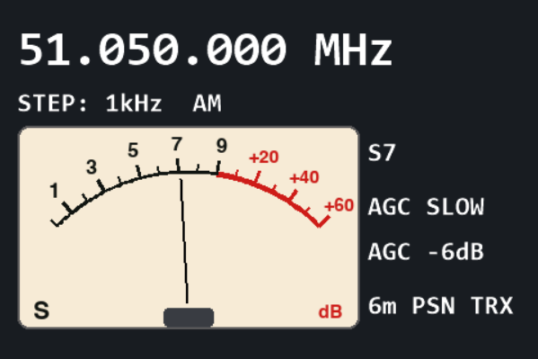
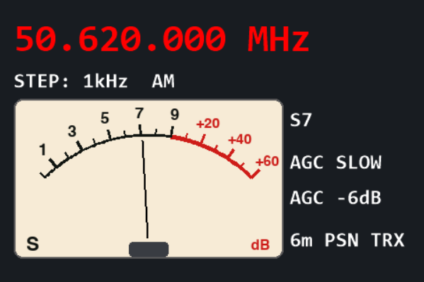

# LCD 画面データ（.HMI）の作成手順（Nextion）

PSN TRX の LCD に書き込む画面データの作り方です。スケッチは LCD に `t0.txt="…"`（文字）・`picq`（メーターの描き直し）・`line`（針）を送るだけなので、画面データには **背景画像 1 枚と、テキスト部品 t0〜t6** があれば足ります（ボタンやスクリプトは不要）。

作成済みの画面データがこのフォルダにあります。**Nextion NX4832K035 には [`PSN_TRX_K035.tft`](PSN_TRX_K035.tft)、TJC4832T135_011 には [`PSN_TRX_TJC.tft`](PSN_TRX_TJC.tft) をそのまま書き込めば使えます**（書き込み方は 7 章・9 章）。

| ファイル | 内容 |
|---|---|
| [`PSN_TRX_K035.HMI`](PSN_TRX_K035.HMI) | NX4832K035（Enhanced）用の編集用ファイル（Nextion Editor で開く。画面を変えるときはこれを直して .tft を出し直す）。**文字を大きくした版**（フォント 0 = 28 ドット、フォント 1 = 52 ドット、部品は 5 章の値。2026-11-28 にフォント 2 = 32・3 = 36 ドットと電源電圧の t7 を追加し、t0 の幅を 364 に） |
| [`PSN_TRX_K035.tft`](PSN_TRX_K035.tft) | LCD に書き込むファイル（**NX4832K035 用**、28/52 ドット版。Nextion Editor 1.68.2 でコンパイルし、シミュレータで 6 章の表示を確認済み） |
| `consolas28.zi`・`consolas52.zi` | フォント 0（28 ドット）・フォント 1（52 ドット）。Consolas 太字、iso-8859-1。PSN_TRX_K035.HMI に入っている |
| `consolas32.zi`・`consolas36.zi` | フォント 2（32 ドット、Consolas、半角英数字、t2 の機種名）・フォント 3（36 ドット、Consolas 太字、電源電圧の t7）。2026-11-28 に PSN_TRX_K035.HMI に追加 |
| [`PSN_TRX_TJC.HMI`](PSN_TRX_TJC.HMI)・[`PSN_TRX_TJC.tft`](PSN_TRX_TJC.tft) | TJC4832T135_011 用（9 章） |

> NX4832T035（Basic）用の画面データ（PSN_TRX.HMI / .tft、24/32 ドットの旧版）とそのフォント（consolas24.zi・consolas32.zi）は、使う予定がないので 2026-11-23 に削除しました。T035 を使うときは、PSN_TRX_K035.HMI を開いて Device で機種を NX4832T035_011 に変え、.tft を出し直してください。

> **注意（2026-11-19）**: 下の 3・5 章は、文字を大きくした版（周波数 52 ドット・ほか 28 ドット）の値に変えました。**NX4832K035 用（PSN_TRX_K035.HMI / .tft）は新しい値に更新済み**です。TJC 用（PSN_TRX_TJC.HMI / .tft）も 2026-11-23 に更新済み（9 章）。

以下は、この画面データを一から作るときの手順です。

| LCD | エディタ | 機種の選択 |
|---|---|---|
| **Nextion NX4832K035**（Enhanced、本機で使っているもの。`PSN_TRX_K035.tft` を書き込む） | Nextion Editor | NX4832K035_011 |
| Nextion NX4832T035（Basic）・NX4832F035（Discovery） | Nextion Editor | NX4832T035_011・NX4832F035_011（画面データは用意していない。K035 用の .HMI の機種を変えて作る） |

- 機種名は LCD の裏のシールで確かめてください（末尾 `_011` は抵抗膜タッチ付き、`_010` はタッチなし。どちらでもかまいません）。
- .tft は機種ごとに別のファイルです。K035 用の `PSN_TRX_K035.tft` はほかの機種には書き込めないので、シールの型番に合うものを使います。
- **TJC の LCD（TJC4832T135_011 など、手元の古いもの）用の .tft は、古い版のエディタ USART HMI 1.67.6 で作らないと使えません。** 最新の 1.68.2 で作った .tft を書き込むと、横向きの画面が崩れます（9 章の注意）。1.67.6 は tjc1688.com の「旧版本上位机下载」にあります。
- 中国国内向けの TJC（TJC4832T135 など）は見た目が同じでも、エディタと画面データ（.HMI / .tft）に互換性がありません。Nextion Editor で作った画面データは Nextion の LCD にだけ書き込めます。TJC の LCD を使うときは、TJC のエディタで画面データを作り直します（9 章）。

---

## 1. 新しいプロジェクトを作る

1. エディタを起動し、**File → New** で保存先とファイル名（例: `PSN_TRX_K035.HMI`）を決めます。
2. 機種の選択画面で、上の表の機種を選びます。
3. **Display**（表示方向）で **横向き 90°**（Horizontal / 90）を選び、**480 × 320** になっていることを確かめます。
4. **Character encoding**（文字コード）は `iso-8859-1` でかまいません（表示する文字は半角英数字だけです）。
5. OK を押すと、page0 だけがある空の画面ができます。

## 2. 背景画像（ピクチャ 0）を取り込む

1. 左下の **Picture** 欄の **+** を押し、このフォルダの [`background.png`](background.png)（480×320）を選びます。
2. 番号 **0** として登録されたことを確かめます（スケッチの `picq …,0` がピクチャ 0 を使います）。

> 背景画像を作り直すときは `python3 make_background.py`（Pillow が必要）。目盛りの位置はスケッチの `METER_*` と同じ値になっています。

## 3. フォントを作る（4 種類）

**Tools → Font Generator** で、次の 4 つを作ってプロジェクトに追加します。**追加した順に フォント 0・1・2・3 になる**ので、必ず 28 → 52 → 32 → 36 ドットの順に追加します。

| 番号 | 高さ | 文字の範囲 | 用途 |
|---|---|---|---|
| 0 | **28** | 半角英数字（ASCII） | t1〜t6 |
| 1 | **52** | 半角英数字（ASCII） | t0（周波数） |
| 2 | **32** | 半角英数字（ASCII） | t2（機種名）。どの部品にも使われていないフォントはコンパイルで .tft に入らない |
| 3 | **36** | 全文字（iso-8859-1） | t7（周波数の右の電源電圧） |

> 2026-11-19 に文字を大きくしました（周波数 32 → 52 ドット、ほか 24 → 28 ドット）。番号（0 = 小、1 = 大）は変えていないので、スケッチは同じまま使えます。半角 1 文字の幅は高さの半分（28 ドット = 14px、52 ドット = 26px）として部品の幅を決めています。

- 書体は読みやすい太めのもの（例: Consolas Bold、Arial Bold）がおすすめです。幅が一定の書体だと、周波数が変わっても文字の位置が動きません。
- Encoding は `iso-8859-1` を選びます。日本語は使わないので、文字数の少ないフォントで足ります。
- 生成後に「Add the generated font?」（作ったフォントを追加するか）と聞かれたら **Yes**。左下の **Fonts** 欄に 0・1・2・3 の順で並べば OK です。
- 作成済みの .zi を使うときは、**Fonts** 欄の **+**（Add）でこのフォルダの .zi を選びます（consolas28 → consolas52 → consolas32 → consolas36 の順）。
- t7 のない画面データ（今の TJC 用など）で使うときは、スケッチの `VSUP_USE_T7` をコメントアウトします（電源電圧をフォント `VSUP_FONT` で直接描く）。

## 4. page0 の背景を設定する

page0 を選び（何もない所をクリック）、右の属性欄で次のとおりにします。

| 属性 | 値 |
|---|---|
| sta | **image** |
| pic | **0** |

画面にメーターの目盛りが表示されれば OK です。

## 5. テキスト部品 t0〜t6 を置く

ツールボックスの **Text** を 8 回押して部品を 8 個置き、それぞれ右の属性欄を次のとおりにします。**部品の名前（objname）がスケッチと一致していることが一番大事**です（部品を置いた順に t0, t1, … と自動で名前が付くので、t0 から順に置くと楽です）。

| objname | x | y | w | h | font | xcen（横寄せ） | txt_maxl | 表示する内容 |
|---|---|---|---|---|---|---|---|---|
| t0 | 16 | 16 | **364** | **56** | **1** | 0（左） | 16 | 周波数（50.150.000 MHz。バンド外は赤）。14 文字 × 26px = 364px |
| t1 | 16 | **76** | **312** | 32 | 0 | 0（左） | 32 | STEP・LOCK・AM（設定モード中はメニュー） |
| t2 | **328** | 256 | **152** | 32 | **2** | 0（左） | 12 | 機種名（6m PSN TRX）。32 ドットで約 148px、画面の右端まで使う |
| t3 | **328** | 120 | **148** | 32 | 0 | 0（左） | 8 | S メーター値（送信中は ALC） |
| t4 | **328** | 168 | **148** | 32 | 0 | 0（左） | 12 | AGC FAST / SLOW / OFF（送信中は赤い TX） |
| t5 | **328** | **76** | **148** | 32 | 0 | **2（右）** | 12 | RIT |
| t6 | **328** | 208 | **148** | 32 | 0 | 0（左） | 12 | AGC の量（AGC -12dB）。送信中は送信時間（TX 0:42） |
| t7 | 380 | 36 | 96 | 36 | **3** | **2（右）** | 10 | 電源電圧（12.9V）。pco = **2016**（緑）、11.5V 未満はスケッチが赤に |

- 太字は 24/32 ドット版から変えた値です。t1 の一番長い表示は `> RIT: +9.99kHz [OK]`（20 文字 = 280px）、右の列は `RIT +9.99k`・`6m PSN TRX`（10 文字 = 140px）です。

8 個とも共通で、次の属性も変えます。

| 属性 | 値 | 理由 |
|---|---|---|
| sta | **crop image** | 文字の後ろに背景画像をそのまま見せる |
| picc | **0** | 切り抜く背景 = ピクチャ 0 |
| pco | **65535**（白） | 文字の色。暗い背景で読めるように（t4 は送信中、t0 はバンド外、t6 は送信 3 分超えのときだけスケッチが赤 63488 に変える） |
| ycen | 1（中央） | 縦方向は枠の中央 |
| isbr | **False** | 折り返さない（長い文字が 2 行にならない） |
| txt | **空にする** | 初期値の `newtxt` を消す。表示はスケッチが送る |

- sta を crop image にしない場合は、sta = solid color・**bco = 6372**（背景画像の地の色と同じ）にします。
- **メーター面（x 16〜320、y 112〜292）には部品を置かないでください。** スケッチが針（とピークホールドの赤い印）を描くとき、この範囲を背景画像で描き直します。
- 2026-11-25 のスケッチで足した表示（バンド外の赤・LOCK・AM・送信時間・ピークホールド）は、この t0〜t6 と背景画像だけで出すので、画面データを作り直す必要はありません。
- t1 は横幅いっぱいまで文字が入るので、文字が切れるときはフォント 0 の書体を細めにします。

## 6. シミュレータで確かめる

1. **Compile** を押し、エラーがないことを確かめます。
2. **Debug** を押すとシミュレータが開きます。
3. 左下の **Instruction Input Area**（命令の入力欄）に、次の行を貼り付けて Enter を押します（末尾の `FF FF FF` は入力不要）。

```
t0.txt="50.150.000 MHz"
t1.txt="STEP: 1kHz"
t2.txt="6m PSN TRX"
t3.txt="S7"
t4.txt="AGC FAST"
t5.txt="RIT +0.25k"
t6.txt="AGC -12dB"
picq 16,112,305,181,0
line 166,269,160,159,0
line 167,269,161,159,0
```

文字がそれぞれの位置に出て、メーターの S7 付近に針が描かれれば OK です。送信中の表示は次で確かめられます。

```
t3.txt="ALC 6dB"
t4.pco=63488
t4.txt="TX"
t6.txt=""
picq 16,112,305,181,0
line 178,270,202,162,0
line 179,270,203,162,0
```

AM モードとバンド外の警告（周波数が赤）は、次の命令で確かめられます。貼り付けてもまとめて実行されないときは、1 行ずつ入れて Enter を押してください。

```
t0.pco=65535
t0.txt="51.050.000 MHz"
t1.txt="STEP: 1kHz  AM"
t3.txt="S7"
t4.pco=65535
t4.txt="AGC SLOW"
t5.txt=""
t6.txt="AGC -6dB"
picq 16,112,305,181,0
line 166,269,160,159,0
line 167,269,161,159,0
```



続けて次を入れると、周波数が赤になります（AM で 50.620 MHz は AM の区分（51.000 MHz から）の外）。

```
t0.pco=63488
t0.txt="50.620.000 MHz"
```



この 2 枚（`docs/images/lcd_am.png`・`lcd_am_out_of_band.png`）は、PSN_TRX_K035.HMI を Nextion Editor 1.68.2.3035 のシミュレータで開いて上の命令を入れ、表示を取り込んだものです（Windows の表示倍率 125% のため 599×399 ドット）。


## 7. LCD に書き込む

どちらか一方の方法で書き込みます。

- **microSD カード**: **File → TFT file output** で `.tft` を作り、FAT32 でフォーマットした microSD に **1 つだけ** コピーします。電源を切った LCD に差して電源を入れると書き込みが始まり、終わったら電源を切ってカードを抜きます。
- **USB シリアル変換器**: LCD の TX/RX/5V/GND を USB シリアル変換器につなぎ、**Upload** で書き込みます。本機につないだまま書き込む場合は、XIAO を外してから行ってください（XIAO の D6 が LCD の RX につながっているため）。

## 8. 本機で確かめる

- 電源を入れると、前回の周波数・STEP・機種名・S メーター・AGC が表示されます。AGC が FAST か SLOW のとき t6 に `AGC 0dB` などが出れば t6 も OK です。
- 文字が出ない部品があるときは、その部品の **objname**（t0〜t6）と **txt_maxl**（短すぎると文字が切れる・表示されない）を確かめてください。
- LCD との通信速度は、スケッチが起動時に 9600bps から 115200bps に切り替えます。画面データ側の通信速度の設定は初期値（9600bps）のままにしてください。

## 9. TJC の LCD を使う場合

TJC（TJC4832T135 など、480×320 の 3.5 インチ）でも、スケッチが送る命令（`t0.txt="…"`・`picq`・`line`・`baud=`）は同じなので、**スケッチは変えずに使えます**。ただし画面データ（.HMI / .tft）とフォント（.zi）は Nextion 用のものが使えないので、TJC のエディタで作り直します。手順は 1〜7 章と同じで、違うところだけを書きます。

| 項目 | Nextion | TJC |
|---|---|---|
| エディタ | Nextion Editor | **USART HMI 1.67.6**（TJC の公式サイト tjc1688.com の「旧版本上位机下载」からダウンロード。**1.68.2 は使わない**、下の注意を参照） |
| 機種の選択 | NX4832K035_011 | LCD の裏のシールの型番（例: TJC4832T135_011） |
| フォント | consolas28.zi・consolas52.zi | **TJC のエディタで作り直す**（Nextion の .zi は読み込めない） |
| 書き込むファイル | PSN_TRX_K035.tft | PSN_TRX_TJC.tft（TJC4832T135 用。Nextion 用の .tft は使えない） |

> **注意（2026-11-23、TJC4832T135_011 で確認）: 古い TJC の LCD 用の .tft は、古い版のエディタ（USART HMI 1.67.6）で作らないとだめです。**
> - **USART HMI 1.68.2 で作った横向き（90°・270°）の .tft は、表示が崩れる**（絵が左右に 2 つ並んで横につぶれ、細い横縞が入る）。縦向き（0°）は正常。TJC 公式の工場出荷時の画面データでも同じだったので、エディタ 1.68.2 の問題。**同じ .HMI を 1.67.6 で出し直すと正常に表示される**。
> - 1.67.6 では フォントの作成（字库制作）が 0% のまま進まないことがある。そのときはフォント（.zi）だけ 1.68.2 で作り、1.67.6 で 字库 欄の ↻（置き換え）で入れ替えればよい（.zi は 1.67.6 でも読める）。
> - 1.67.6 は起動時に更新を勧められるので、「下次再提醒」（次回また通知）を押す。動かすには Windows の **.NET Framework 3.5** が必要。
> - スケッチは、起動時に命令の区切り（`FF FF FF`）だけを先に送ってから `baud=115200` を送る（2026-11-23 の修正）。TJC は通信速度を変えた直後の最初の命令を「命令エラー」（`1A`）として捨てるので、これがないと 9600bps のまま残り、文字も針も出ない。Nextion でもそのまま動く。

エディタの表示が中国語のときの、主な項目の名前です。

| 1〜7 章の名前 | USART HMI（中国語表示） |
|---|---|
| File → New | 文件 → 新建 |
| 表示方向 横向き 90° | 显示方向 → 横屏 90 |
| Character encoding | 字符编码 |
| Picture 欄 | 图片 |
| Tools → Font Generator | 工具 → 字库制作 |
| Fonts 欄 | 字库 |
| Text 部品 | 文本 |
| sta = image / crop image / solid color | sta = 图片 / 切图 / 单色 |
| Compile / Debug | 编译 / 调试 |
| Instruction Input Area | 指令输入区 |
| TFT file output | 文件 → 输出生产文件 |
| Upload | 下载 |

- **文字コード（字符编码）**: 表示するのは半角英数字だけなので、初期値（gb2312 など）のままでかまいません。フォントを作るときも同じ文字コードを選びます。
- **フォント**: 3 章のとおり、高さ 28 を先に、52 を後に作って追加します（フォント 0・1 の順）。文字の範囲は半角英数字（ASCII）だけで足ります。
- **背景画像・部品の配置・属性**: 2・4・5 章の値（ピクチャ 0、t0〜t6 の x・y・w・h・font・txt_maxl、sta = 切图・picc = 0・pco = 65535・isbr = False）をそのまま使います。色の値（65535 = 白、63488 = 赤、6372）も Nextion と同じです。
- **確かめ方**: 6 章の命令を 调试（シミュレータ）の 指令输入区 に貼り付けて、同じ表示になれば OK です。
- **書き込み**: 输出生产文件 で出した .tft を microSD で書き込むか（microSD スロットがある機種）、USB シリアル変換器から 下载 で書き込みます。XIAO を外してから書き込むのは 7 章と同じです。
- **通信速度**: 画面データ側の設定は初期値（9600bps）のままにします。スケッチが起動時に 115200bps に切り替えます。

TJC 用の画面データも作成済みです（2026-11-23 に文字を大きくした版（28/52 ドット、部品は 5 章の値）に更新。.tft は USART HMI 1.67.6 で出力し、シミュレータで 6 章の表示を確認済み。旧版の 1.68.2 で出した .tft は横向きが崩れていた）。

| ファイル | 内容 |
|---|---|
| [`PSN_TRX_TJC.HMI`](PSN_TRX_TJC.HMI) | 編集用の元ファイル（USART HMI 1.67.6 で開く） |
| [`PSN_TRX_TJC.tft`](PSN_TRX_TJC.tft) | LCD に書き込むファイル（**TJC4832T135_011 用**、1.67.6 で出力） |
| `tjc_consolas28.zi`・`tjc_consolas52.zi` | TJC 用のフォント 0（28 ドット）・1（52 ドット）（Consolas 太字、ASCII、gb2312）。.HMI にも入っている |

- 機種が TJC4832T135 でないとき（TJC4832T035 など）は、`PSN_TRX_TJC.HMI` を開いて 设备 で機種を選び直し、输出生产文件 で .tft を出し直してください。
- TJC と Nextion で .tft や .HMI のファイル名を変えて、取り違えないようにしてください。

---

画面配置の元の表は [`manual/README.md`](../../manual/README.md) の 7 章にあります。部品を増やしたり位置を変えたりしたときは、両方を直してください。
