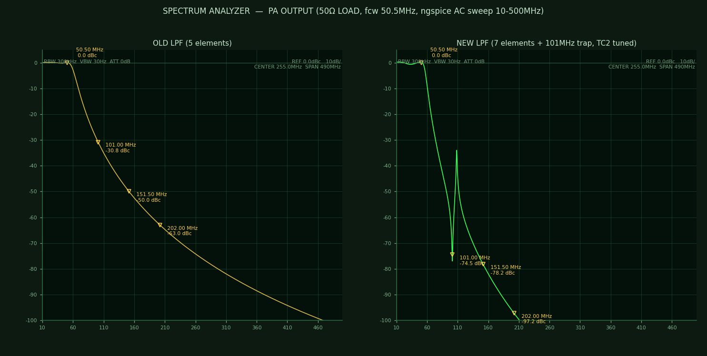
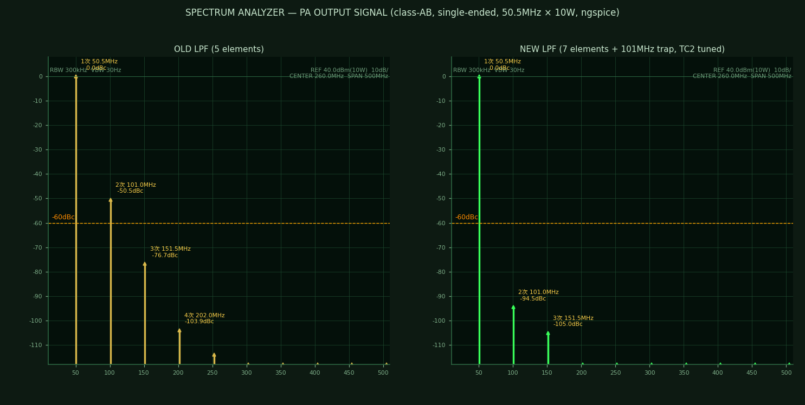
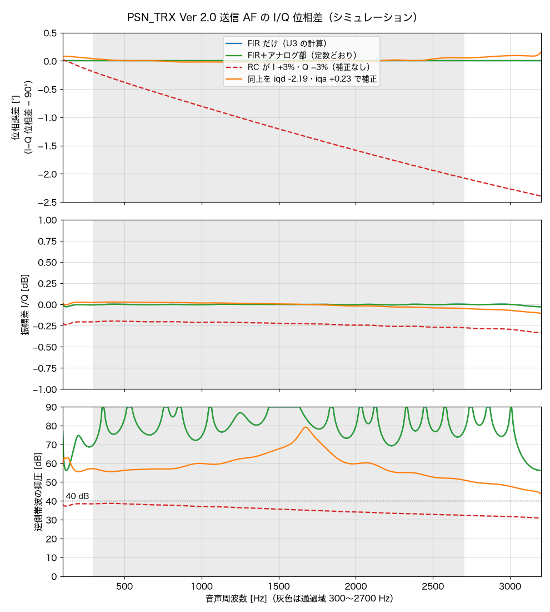
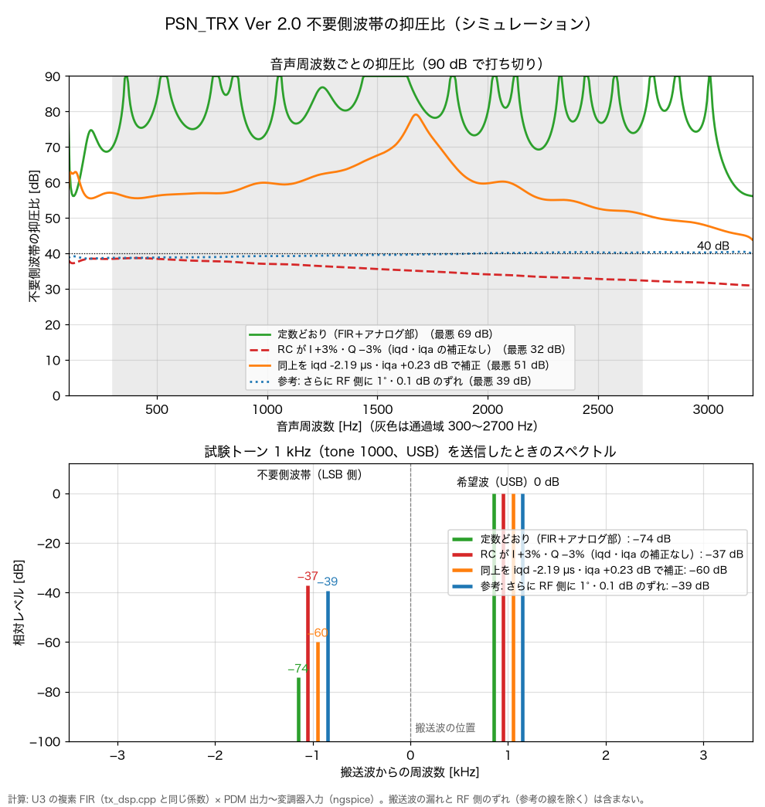

# PSN_TRX_XIAO_ESP32C3-V2

Seeed Studio XIAO ESP32C3 + Si5351 を使用した PSN 方式 SSB トランシーバー（KiCad 10.0）。

> **V2 Ver 1.0（作業中）**: [PSN_TRX_XIAO_ESP32C3](https://github.com/kazushinjo/PSN_TRX_XIAO_ESP32C3) を元に、受信部をダイレクトコンバージョンから SSB のシングルスーパー（IF 12MHz・ラダーフィルタ・積検波）に変更した。回路図・基板（134.1 × 129.7mm、配線済み・DRC エラー 0）・ファームウェア（ビルドのみ）・部品表・シミュレーションは V2 に更新済み。**実機は未確認**。製造データ（ガーバー・JLCPCB 用ファイル、`kicad/production/`）は 2026-10-30 に V2 Ver 1.0 の基板から出力済み（基板シルク「V2 Ver 1.0」）。部品実装図（`docs/PSN_TRX_部品実装図.pdf`、ブロック別 13 ページ＋調整箇所）と調整手順（[`manual/調整手順.md`](manual/調整手順.md)）は V2 Ver 1.0 に更新済み。組み立て説明書などの docx と `kicad/PSN_TRX_部品配置図.pdf` は未更新。

## 概要

50MHz 帯 PSN（位相シフト網）方式 SSB トランシーバー。VXO（水晶発振器）を
Si5351A クロックジェネレーターによる VFO に置き換え、Seeed Studio XIAO ESP32C3 でデジタル制御する。

Si5351 の CLK0（0°）/ CLK1（90°）二相出力を直接バランスドモジュレーターへ供給することで、
従来の RF PSN（RC 位相シフト回路）も不要となる。

## 主な仕様

| 項目 | 内容 |
|---|---|
| クロックジェネレーター | Si5351A（AE-Si5351A モジュール、I2C 制御） |
| 周波数範囲 | 50.000 〜 51.000 MHz（6m バンド） |
| 受信方式（V2） | SSB シングルスーパー: 入力同調 L18 → RF 増幅 Q20・Q25（J310 カスコード、AGC 付き）→ 出力同調 L19 → 第 1 混合 U4（NJM2594V）→ 混合後増幅 Q21・L 整合 → 12MHz ラダーフィルタ（水晶 6 個）→ IF 増幅 Q2（3SK59、AGC）→ 積検波 U5（NJM2594V）→ AF 前置増幅 Q23 → AF 段 |
| CLK0 出力 | 送信中: 0° → C58・LPF（L13）・VR6 → バランスドモジュレーター 1（D4/D5）。受信中: 第 1 局発（表示周波数 − BFO、38〜39MHz）→ Q11 → L9 → U4 |
| CLK1 出力 | 送信中だけ 90° → C59・LPF（L14）・VR7 → バランスドモジュレーター 2（D6/D7） |
| CLK2 出力（V2） | 受信中だけ BFO（約 12MHz、PLLB）→ R77・R78 → U5。USB はフィルタの通過域の下端の外、LSB は上端の外（シリアルの `bfo usb <Hz>` / `bfo lsb <Hz>` で合わせて保存） |
| チューニングステップ | 10Hz / 100Hz / 1kHz / 10kHz / 100kHz |
| 表示 | Nextion NX4832T035（3.5 インチ シリアル LCD、標準）または OLED SSD1306 128×64（コンパイル時に選択） |
| 周波数記憶 | NVS（電源 OFF 後も保持） |
| S メーター・AGC | V2: Q2 の出力を Q22 で増幅して AD8307（対数検波、25mV/dB）で測り、ADS1015（秋月 AE-ADS1015、I2C 0x48）で XIAO が読む。AGC は Q17 で Q2 の G2 を下げる（FAST / SLOW / OFF）。調整値はスケッチの RSSI_S9_MV・AGC_TARGET_MV |
| RIT | ±9.99 kHz・10 Hz 刻み、送信中は自動で外す（送信検出を使うため基板 Ver 1.3 から。Ver 2.0 から送信検出は D0） |
| 送信 I/Q 生成 | マイク → IC2A（約 21 倍）→ A2 の ADC（32kHz）→ 複素 FIR（16kHz、127 タップ、300〜2700Hz）→ I2S の PDM で D10（I）・D8（Q）→ 2 段 RC → 変調器（基板 Ver 2.0 から）。調整はシリアルのコマンド（mic・out・iqd・iqa・sb・tone・alc）。デジタル ALC（FIR の前、効き始め -20 dBFS）で過変調と変調器ドライブ（Q15・Q16）のひずみを防ぎ、送信中はメーターを ALC メーターに |
| 操作 | エンコーダを押すと設定モード（ダイヤルで RIT / STEP / AGC を選び、押して値の変更、もう一度押して確定） |

## ハードウェア構成

```
Seeed Studio XIAO ESP32C3 ─ メインコントローラ
├── Si5351A モジュール (AE-Si5351A) ─ I2C クロックジェネレーター
│   ├── CLK0  送信中 0° → バランスドモジュレーター 1（D4/D5）／受信中 第 1 局発 → Q11 → L9 → U4
│   ├── CLK1  送信中だけ 90° → バランスドモジュレーター 2（D6/D7）
│   └── CLK2  受信中だけ BFO → R77・R78 → U5（積検波）
├── ADS1015 モジュール（I2C 0x48）─ A0 = AD8307 の出力（S メーター・AGC）
├── Nextion NX4832T035 LCD（D6/D7 UART）または OLED（D4/D5 I2C）
├── ロータリーエンコーダ（A=D3, B=D1, SW=D9）
├── A2: 送信中のマイク音声（IC2A → C73・R59、R38/R39 で 1.65V バイアス）→ 複素 FIR で I/Q を作る
│        （V2 では受信音は来ない）
├── D10: 受信中は AGC の PWM（→ R42・C61 → R44 → Q17 で Q2 の G2 を下げる）
│        送信中は PDM の I（→ R61・C75・R62・C76 → C49 → Q15）
├── D8: PDM の Q（→ R63・C77・R64・C78 → C48 → Q16、送信中だけ出力）
└── 送信検出 D0（TX12V → R45/R48 → Q19、送信中 LOW）

  受信と送信はリレー K1 で電源（+9V／TX12V）が切り替わるので、A2・D10 を送受で使い分けられる。
  D0 は起動設定ピン（GPIO2）なので、PTT を押したまま電源を入れない

1W PA: RD06HVF1 (N-ch RF MOSFET) @ 12V, Class AB
```

## 1W パワーアンプ（Q3）

前段（2SC1815 等）の出力（約 20〜30mW）を増幅する終段アンプ。

| 項目 | 内容 |
|---|---|
| トランジスタ | **RD06HVF1**（三菱電機 N-ch RF MOSFET, 175MHz, 6W, TO-220F） |
| 電源電圧 | 12V |
| 動作クラス | Class AB |
| 静止電流 Idq | 200〜400mA（VR2 で調整） |
| 出力 | 約 1W @50MHz |
| 出力 LPF | 5 素子 π 型: C6 33pF → L3（T-50-10 8T、約 0.2µH）→ C4 82pF＋TC1 30p → L1（8T）→ C1 56pF（ドレイン側は C6 に Q3 の出力容量 Coss 約 18pF が加わって約 56pF 相当。カットオフ約 60MHz、2 倍高調波 102MHz で約 −27dB、3 倍高調波で約 −47dB（計算値）。L1/L3 が 0.19〜0.23µH の範囲なら C4＋TC1 の最適値は 90〜106pF で、TC1 の中ほどで合う） |
| 電源 | 送信 12V（リレー K1 の NO 側）、RFC1 10µH 経由。バルク C13 100µF |

### バイアス回路

```
送信12V → R6(330Ω) → VR2(500Ω) の 1 番 ─ VR2 の 3 番 → GND
                         VR2 ワイパー(2 番) → R7(10Ω) → Q3 ゲート
```

- ゲート電圧の可変範囲は 0〜約 7.2V（13.8V 電源では約 8.3V）。**最初の送信前に VR2 を GND 側（ゲート 0V）いっぱいに回しておく**（上側いっぱいだと電流が流れすぎて Q3 を壊すおそれがある）
- 無変調で送信し、VR2 を少しずつ回してドレイン電流 (Idq) を 200〜400mA に合わせる。RD06HVF1 のしきい値電圧 Vth は 1.9〜4.9V（データシート）で、データシートの代表特性では Vgs 約 4V から電流が流れ始め、約 5V で 0.3A。合わせたときのゲート電圧は個体によって 4〜6V 程度になる。電流は Vgs に対して急に増えるので、5V を超えたらゆっくり回す
- 旧回路（2SC1971）のバイアスダイオード・エミッタ抵抗は廃止済み（ソースは GND 直結、D1 は現在 K1 のフライバック用）

詳細は `docs/PSN_TRX_VFO改造仕様書.docx` を参照。

### ヒートシンク

RD06HVF1（Q3）には秋月電子 **17PB046**（GEC ヒートシンク、46.2×17×25mm、黒アルマイト、熱抵抗 11.9℃/W）を使用（基板 Ver 1.5 から。それまでは 20PB020、15.8℃/W）。
Q3 のタブを基板図の上側（HS1 側）に向け、タブの M3 穴でヒートシンクの取付面にネジ止めする。ヒートシンクの脚ピン（φ1.4、ピッチ 30mm、取付面から 3mm）用に、基板へ φ1.6 の穴（NPTH）を 2 個設けている（HS1）。M3 ねじ穴は基板面から 19mm の高さ。
高さは 20PB020 と同じ 25mm なのでケースはそのまま使える。ヒートシンクの右端がふた上の LCD 基板の下に入らないよう、Q3 とヒートシンクは Ver 1.4 より 2.5mm 左にある（LCD 基板の端から約 1.5mm 離れる）。

## シミュレーション結果（ngspice）

回路図のネットリストから定数を直接読み込み、KiCad 同梱の ngspice（libngspice）で計算した結果です（基板 Ver 2.0）。スクリプトと全結果は [`kicad/sim/`](kicad/sim/) にあり、`./run.sh` で再計算できます（結果は `kicad/sim/results.txt`）。トランジスタはデータシートの代表値から作った簡易モデルなので、実機では測定で確認してください。

### PA 出力 LPF（5 素子 → 7 素子＋2 倍波トラップ）

LPF だけの周波数特性（50Ω 終端、10〜500MHz）。左が Ver 1.7 までの 5 素子、右が Ver 1.8 の 7 素子＋101MHz トラップ（TC2 を合わせた状態）。



PA 出力のスペクトル。PA（RD06HVF1、シングル AB 級）自身の高調波を 2 倍波 約 −20dBc・3 倍波 約 −27dBc とし、上の LPF を通した値です。出力に対する比（dBc）で読む図です（図のタイトルの「10W」は計算時の基準値で、本機の出力は約 1W）。破線は 1W を超える場合の許容値 −60dBc。



| | 5 素子（Ver 1.7 まで） | 7 素子＋トラップ（Ver 1.8、TC2 調整後） |
|---|---|---|
| LPF の減衰（2 倍波 101MHz） | −27〜−31dB | −70〜−76dB |
| LPF の減衰（3 倍波 151.5MHz） | −47〜−51dB | −75〜−80dB |
| 挿入損失（50.5MHz） | 約 0.17dB | 0.41〜0.53dB |
| 出力の 2 倍波（図の例） | −50.5dBc | −94.5dBc |
| 新スプリアス規定（1W 以下 −43dBc／1W 超 −60dBc） | 1W 超では満たさない | 満たす見込み |

減衰の範囲は、L1/L3/L16 ±7%・Q3 の出力容量 18〜25pF・トラップのコイル ±7% のすべての組み合わせでの値です。**TC2 を合わせないと 2 倍波が −30dB 程度に戻ることがある**ので、組み立て後に 2 倍波（約 101MHz）が最小になるよう TC2 を調整してください（組み立て説明書 7.5）。規定への適合は実測（スペクトラムアナライザ）で確認が必要です。

### 受信の前段の利得

前段の利得は R67（2.2kΩ）で約 20dB に抑えています（10kΩ なら +28dB・雑音指数 1.0dB だが、混合器に入る信号が 8dB 大きくなる）。その分は Q23 の利得（R97 ÷ R96 ≒ 12）で戻しています。

### そのほかの主な結果

| 項目 | 結果 |
|---|---|
| 直流動作点（電源 11/12/13.8V、hFE 下限〜上限） | 全段とも正常範囲。AF 出力段のアイドル 37〜68mA（R27 最大 0.47W、1W 品）、Q8 最大 0.21W |
| J310 カスコード（Q4・Q5、IF 増幅） | 個体差で 7.5〜22mA（標準 14mA）。R5 で 10〜15mA に合わせる |
| J310 カスコード（Q20・Q25、RF 増幅、V2） | Id 約 15.5mA（R66 100Ω）、Q25 の損失 最大 0.12W |
| 送信 AF 系（マイク → A2） | 1kHz 基準で 300Hz +0.8dB、2700Hz −0.5dB。マイク 1Pa（1kHz）で A2 に約 95mVrms |
| 送信 AF 系（PDM 出力 → 変調器入力） | 1kHz 基準で 300Hz 0dB、2700Hz −0.4dB。PDM の 78kHz で −30dB 以下 |
| I/Q 位相差 | 90° からのずれ 0°（FIR の計算）→ 逆側帯波の抑圧 約 70dB。RC が I/Q で ±3% ずれると最大 2.1°（約 32dB）、iqd・iqa で補正して約 50dB（下の図） |
| 受信 AF 系（積検波 U5 → Q23 → スピーカー、V2） | 1kHz 基準で 300Hz +0.3dB、2700Hz −2.0dB、利得 41.9dB（音量 0.9）。歪み率 10mW 1.1%、50mW 3.1%、80mW 4.9% |
| 受信の前段（V2、入力同調 → Q20・Q25 → 出力同調） | 電力利得 +20.0dB、雑音指数 0.94dB、IIP3 約 −3dBm。−3dB 帯域 49.2〜51.8MHz（50.0・51.0MHz で −0.3・−0.6dB）。イメージ（26.5MHz）−49dB、半 IF（44.5MHz）−20dB、局発の漏れ −33dB。TC3・TC4 は約 9pF・18pF で 50.5MHz。AGC で −15dB |
| ラダーフィルタ（V2、水晶の運動定数は仮定） | 損失 6.1dB、−6dB 幅 2.56kHz、−60dB 幅 7.7kHz、リップル 3dB。終端は両側 330Ω（入力は L21・C93 の L 整合） |
| 受信のレベル配分（V2、NJM2594 の変換利得 0dB と仮定） | S9 で積検波の出力 約 31mV、スピーカーは出力段の最大（約 113mW）。AD8307 の入力 S1 −56dBm・S9 −8dBm（範囲 −75〜+17dBm） |
| 受信の全体（V2、アンテナ → スピーカーを通した計算、full.py） | アンテナ → スピーカー +97dB（1kHz、音量 0.9。小信号の線形計算なので、S9 のスピーカー出力は線形の値（約 1.6W 相当）ではなく出力段の最大 約 113mW で頭打ち）。音声の −6dB 帯域 300〜2830Hz。逆側帯波 −33dB（1kHz）・−49dB（2kHz）、隣接 +5kHz −69dB・−5kHz −78dB、イメージ −49dB。前段の雑音指数 0.9dB・電力利得 +20dB、混合器の雑音指数を 10〜15dB として全体 1.2〜1.9dB、最小検出信号 約 −138dBm（帯域 2.4kHz） |
| 送信の全体（V2、局発・変調器 → PA → LPF → 50Ω の過渡解析、full.py。7T50 の値は仮定） | 変調器の音声入力 100mV で 36mW、800mV で 0.94W（2 倍波 −67〜−81dBc）。キャリアの漏れは VR3・VR4 の中点で −6dBm、合わせると −30dBm（1W に対し約 60dB 下）。I と Q の RF 側の位相差は中点で 93.1°（RF 側だけで抑圧 31dB）→ VR6・VR7 で 90° に合わせ、振幅の差を iqa で補正すると 40dB 以上 |
| PA 入力 | 50Ω 源に対し不整合損失 3.4〜5.3dB（実機で調整） |
| DC-DC 入力フィルタ | 共振 16kHz のピーク 1.5〜4.1Ω。R-78E の負性入力抵抗より十分小さく安定 |
| AGC | PWM の平均 0.55〜0.80V（12 ビットでデューティ 683〜993）で G2 が 4.0V → 0.1〜0.2V。RF 増幅（Q25）−15dB ＋ IF 増幅（Q2）−13dB で計 −28dB |

### 送信 I/Q の位相差（Ver 2.0）

AF の周波数を 100〜3200Hz でスキャンし、I と Q の位相差の 90° からのずれ（上）、振幅差（中）、そこから決まる逆側帯波の抑圧（下）を計算したもの。U3 の FIR はファームウェアと同じ係数（int16 に丸めた後）、その後ろの RC〜変調器入力は ngspice で計算しています（`kicad/sim/iq_scan.py`）。FIR は I 側が左右対称・Q 側が逆対称の係数なので位相差はちょうど 90° になり、抑圧は振幅のわずかなリップルで決まります。RC がずれたときのずれは周波数に比例する（遅延の差になる）ので、`iqd`（遅延差）・`iqa`（利得差）でほぼ打ち消せます。3.3kHz より上は FIR の阻止域（出力がほぼ 0）なので表示していません。



### 不要側波帯の抑圧比（Ver 2.0）

上は音声周波数ごとの抑圧比、下は試験トーン 1kHz（`tone 1000`、USB）を送信したときにスペクトラムアナライザで見える形です（`kicad/sim/sideband.py`）。部品が定数どおりなら約 70dB、RC が I/Q で ±3% ずれても `iqd`・`iqa` の補正で約 50〜60dB。ただし RF 側（Si5351 の 2 出力・変調器）に 1°・0.1dB のずれがあるだけで約 39dB になり、実機の抑圧比はほぼ RF 側で決まります（RF 側は計算に含めていないので、参考の線として重ねています）。



実機での `iqd`・`iqa` の合わせ方（試験トーンと SDR・受信機を使う手順、記録表つき）は [`manual/送信IQ調整手順.md`](manual/送信IQ調整手順.md) にまとめています。

詳しい数値は評価試験報告書（第8版）6.5 と JLCPCB 提出資料 4.1・4.2 にまとめています。

## KiCad ライブラリ状態

| ファイル | 状態 |
|---|---|
| `kicad/PSN_TRX.pretty/` | 全12フットプリント KiCad 10 形式 ✅ |
| `kicad/PSN_TRX.kicad_sym` | カスタムシンボル（RD06HVF1 含む）✅ |
| `kicad/fp-lib-table` | PSN_TRX ライブラリ登録済み ✅ |
| DRC ライブラリエラー | **0件** ✅ |

## ファイル構成

```
kicad/
  PSN_TRX.kicad_sch       - 回路図
  PSN_TRX.kicad_pcb       - PCB レイアウト（配線作業中）
  PSN_TRX.kicad_sym       - カスタムシンボルライブラリ
  PSN_TRX.pretty/         - カスタムフットプリントライブラリ（12点）
  BOM.md                  - 部品表（Markdown・購入先と購入先の型番付き）
  bom.csv                 - 部品表（kicad-cli で回路図から出力した CSV）
  bom_purchase.csv        - 購入用部品表（購入先・型番・販売コード・入数・価格、UTF-8 CSV）
  make_bom_purchase.py    - bom.csv から bom_purchase.csv を作り BOM.md に購入先を入れるスクリプト
  sim/                    - ngspice によるアナログ部の計算（run.sh → results.txt、iq_scan.py → I/Q 位相差のグラフ）
  production/             - JLCPCB 提出用（ガーバー zip・CPL・BOM・提出資料）
PSN_TRX_XIAO_ESP32C3/
  PSN_TRX_XIAO_ESP32C3.ino - XIAO ESP32C3 のスケッチ（VFO・表示・S メーター・AGC）
  tx_dsp.cpp / tx_dsp.h    - 送信 I/Q の生成（ADC・複素 FIR・PDM）と受信音のサンプリング（Ver 2.0）
docs/
  PSN_TRX_VFO改造仕様書.docx  - 改造仕様書（部品リスト・回路図含む）
  images/                     - README の図（PA 出力 LPF の特性・PA 出力のスペクトル・送信 I/Q の位相差）
```

## 変更履歴

| 日付 | 変更内容 |
|---|---|
| 2026-10-30 | 受信部を改造: RF 増幅を 2N3819 1 石 → J310 カスコード（Q20・Q25、Q25 のゲートに AGC）、複同調 BPF → 入力同調（L18）＋出力同調（L19、R67 2.2kΩ で制動）、R65・C81・L20 を削除。積検波の後に AF 前置増幅 Q23（2SC1815、R96 8.2k・R97 100k・R98 1k）を追加、R80 1k・C103 0.047µ。表面実装は使わない方針で J310 は 4 個とも TO-92（Q4・Q5 も SOT-23 から変更。NJM2594V だけ例外）。基板: 受信部を置き直し・再配線（DRC 0・未配線 0・回路図との不一致 0）。部品表を更新。ファームウェア: RSSI_S9_MV 1900・AGC_TARGET_MV 1750・AGC_RANGE_DB 28。シミュレーションを新しい回路に合わせ、V1 との比較を追加 |
| 2026-10-29 | 回路図: 受信部を上・送信系／制御／電源を下に配置し、受信部は図面の幅いっぱいに信号の流れに沿って並べ直し、低周波増幅を積検波の後に移した。ラベルでつないでいたところ（RX_ANT・LO_RX・CLK2・I2C・電源など）はすべて線で結線（1 か所だけの PSN_I_OUT・PTT を除く。ネットのつながりは変えていない）。評価試験報告書の 6.5 回路シミュレーションを V2 の結果に差し替え。旧部分の削除跡・古い注記を整理。基板: 受信部の部品を機能ごと・配線最短になるよう置き直し（RF の都合でフィルタの入口と出口、アンテナ入力と BFO は離す）、基板を 134.1 × 145mm → 134.1 × 129.7mm に縮小、Freerouting で配線（DRC エラー 0・未配線 0）。前の作業で消えていた旧部分の配線（PWR_IN・TX12V・J7・J8 など）を V1 から戻した。ファームウェア: 受信中は CLK0 = 局発・CLK2 = BFO、S メーター・AGC を ADS1015（AD8307）で測る、`bfo` コマンド。シミュレーションを V2 の回路で通るよう直し、IF 増幅・S メーター・レベル配分の計算を追加 |
| 2026-10-29 | 回路図: 受信部を 12MHz の SSB シングルスーパーに変更（図面を A0 に広げ、新しい受信部を下側にネットラベルで結線）。50MHz 複同調 BPF（T30-6）→ 2N3819 → NJM2594V（第 1 混合、局発 = CLK0 → Q11 → L9 で受信周波数 − 12MHz）→ 2SC1815 → 12MHz ラダーフィルタ（水晶 6 個）→ Q2（3SK59 / J310 カスコード、IF 増幅・AGC）→ NJM2594V（積検波、BFO = CLK2）→ 今の AF 段。S メーターは AD8307 → ADS1115（I2C）。L2・L4・C3・Q7・R8・R10・R12・C16・C20・C50・R37 を削除、C29 15p→27p、C11 15p→33p。ERC 違反 0。部品表を更新。基板・ファームウェアはまだ V1 のまま |
| 2026-10-29 | PSN_TRX_XIAO_ESP32C3 から PSN_TRX_XIAO_ESP32C3-V2 を作成。受信部を SSB スーパーに変更するため、出典の記載を README・docs・スケッチ・資料から削除 |

## クレジット

| 役割 | 名前 |
|---|---|
| 局部発振（XIAO ESP32C3 + Si5351）・RF の移相・1W 終段・出力 LPF・電源・送受切替・制御の設計、基板・ケース設計 | JA6FUF（kazushinjo） |
| 回路検証・基板配置配線・ドキュメント作成の支援 | Claude Code（Anthropic） |

### 使用しているソフトウェア・ライブラリ

| 名前 | 作者 | ライセンス | 用途 |
|---|---|---|---|
| [Etherkit Si5351](https://github.com/etherkit/Si5351Arduino) | Jason Milldrum (NT7S) | GPL v3 | Si5351 制御（ファームウェア） |
| [Adafruit SSD1306](https://github.com/adafruit/Adafruit_SSD1306) / [Adafruit GFX](https://github.com/adafruit/Adafruit-GFX-Library) | Adafruit Industries | BSD | OLED 表示（OLED 選択時のみ） |
| Arduino-ESP32（Preferences ほか） | Espressif Systems | LGPL 2.1 | ESP32-C3 コア |
| [KiCad](https://www.kicad.org/) 標準シンボル・フットプリントライブラリ | KiCad Library Team | CC-BY-SA 4.0（設計への利用は例外規定により制限なし） | 回路図・基板 |
| [OpenSCAD](https://openscad.org/) | OpenSCAD 開発チーム | GPL v2 | ケース設計 |

## ライセンス

このプロジェクト（ファームウェア、KiCad 回路図・基板データ、ケースの OpenSCAD データ、ドキュメント）は
**GNU General Public License v3.0** の下で公開しています。全文は [`LICENSE`](LICENSE) を参照してください。

```
PSN_TRX_XIAO_ESP32C3-V2
Copyright (C) 2026 JA6FUF (kazushinjo)

This program is free software: you can redistribute it and/or modify
it under the terms of the GNU General Public License as published by
the Free Software Foundation, either version 3 of the License, or
(at your option) any later version.

This program is distributed in the hope that it will be useful,
but WITHOUT ANY WARRANTY; without even the implied warranty of
MERCHANTABILITY or FITNESS FOR A PARTICULAR PURPOSE.  See the
GNU General Public License for more details.
```

## ドキュメント

| 資料 | 内容 |
|---|---|
| [`manual/README.md`](manual/README.md) | 操作説明書（各部の名称・周波数の合わせ方・送受信・困ったときは） |
| [`docs/PSN_TRX_組み立て説明書.docx`](docs/PSN_TRX_組み立て説明書.docx) | 部品実装・配線・調整手順 |
| [`docs/PSN_TRX_部品実装図.pdf`](docs/PSN_TRX_部品実装図.pdf) | 部品実装図（全体図＋ブロック別部品表＋裏面 Q4/Q5） |
| [`enclosure/README.md`](enclosure/README.md) | ケース（OpenSCAD。3D 印刷用 STL の出力方法・パネル穴あけ図） |
