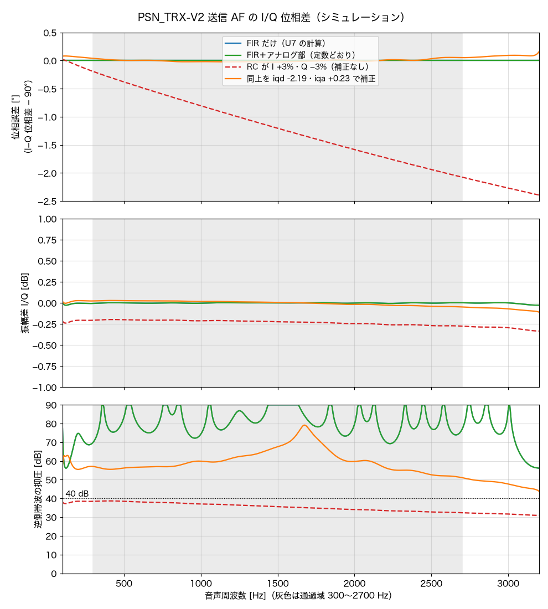
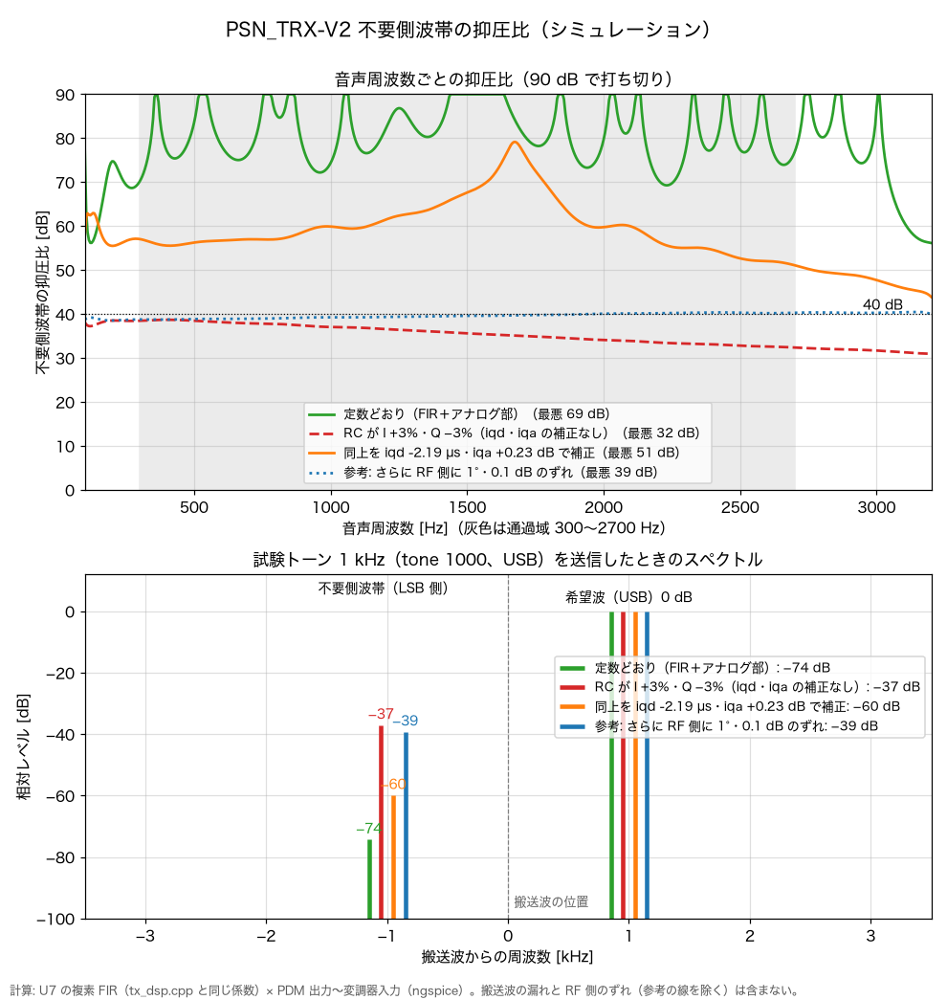

# PSN_TRX-V2 アナログ部シミュレーション結果

- 実行日：2026-11-11
- 対象：PSN_TRX-V2（50MHz SSB トランシーバ、受信 12MHz シングルスーパー）**V2 Ver 1.3**（回路図 `kicad/PSN_TRX.kicad_sch`、2026-11-08 のコミット a3faa34）
- シミュレータ：ngspice-45.2（KiCad 10.0.6 同梱の libngspice を Python から呼ぶ）
- 使用データ：回路図から `kicad-cli` で書き出したネットリスト（`kicad/sim/net.json`）と、`kicad/sim/` の解析モデル
- 実施内容：直流動作点、送信／受信 AF の AC 解析、送信 I/Q スキャン、PA 出力 LPF、PA 入力、RFC1、DC-DC 入力フィルタ、AGC、過渡解析、受信部（前段・ラダーフィルタ・利得・レベル配分）、回路全体（受信・送信）、ブロックごとの確認
- 再計算の方法：`kicad/sim` で `./run.sh`（結果は `results.txt`）。I/Q のグラフは numpy・matplotlib の入った Python で `iq_scan.py`・`sideband.py`

## 総合結果

全解析が正常に収束しました。回路図から作り直した計算用データは前回（2026-11-08、V2 Ver 1.3）と同じで、結果も全項目で一致しました。直流動作点の異常や、設定した部品ばらつき範囲での PA 出力 LPF の大きな劣化は見られませんでした。

一方、次の項目は実機の調整・確認で特に重視してください。

- **2 倍波トラップ（TC4）の調整**：合わせないと 2 倍波の減衰が約 −30dB まで戻る条件がある
- **送信の RF 側の I/Q（VR3・VR4）とキャリアの漏れ（VR5・VR6）**：中点のままでは RF 側だけで逆側帯波の抑圧が 31dB、キャリアの漏れが −6dBm
- **PA 入力の整合**：50Ω 源に対し不整合損失 3.4〜5.3dB
- **2SK192A の個体差と AGC の効き方**：ドレイン電流が 4.7〜10.5mA、AGC の効き始めがトランジスタの hFE で大きく変わる

## 1. 直流動作点

電源 11／12／13.8V、トランジスタ hFE の下限・上限の全 6 条件で計算しました。

| 項目 | 結果 | 評価 |
|---|---:|---|
| Q2・Q3（RF 増幅）、Q6・Q7（IF 増幅）2SK192A-BL カスコード | 各 約 7.4mA | 全電源条件で収束 |
| Q13（2SC2120）／Q12（2SA950）AF 出力段 | アイドル 36.6〜68.3mA、各 最大 237.1mW | 今回のモデル範囲で最大 |
| Q18（2SC1815、送信の 50MHz 増幅） | 11.8〜17.6mA、最大 211.9mW | 2SC1815 の許容 400mW に対し約 53%。実機では温度を確認 |
| R41（AF 出力段のエミッタ側、100Ω 1W） | 最大 0.470W | 1W 品に対し約 47% |
| Q4・Q17（2SK439、局発バッファ・送信増幅） | 各 約 6.7mA、最大 90.6mW | 全条件で一定 |
| U5A（マイクアンプ）出力の直流 | 2.500V | 全条件で一定 |
| マイクのバイアス（+5V から給電） | 2.15V | 電源電圧によらず一定 |
| AGC_PWM＝0V のときの Q21 の電流 | 0mA | AGC オフ（Q2_G2 は 3.7〜4.6V） |
| 送信検出 Q22 | 0.33mA、コレクタ 0.02V（TX_SENSE 0.02V） | 全条件で一定 |

2SK192A-BL の個体差（VGS(off) −1.2〜−3V・IDSS 12〜24mA）では、ソース抵抗 R3・R18（100Ω、回路図どおり）でドレイン電流が 4.7〜10.5mA まで変わります。動作点は得られていますが、受信感度・歪み・消費電流への影響は実機で確認し、必要なら R3・R18 で 5〜8mA に合わせてください（47Ω で 6.8〜14.8mA、150Ω で 3.7〜8.4mA）。

## 2. 送信・受信 AF

### マイク入力から AF_ADC（U7 の A2）

- 300〜2700Hz の相対レベル：+0.1〜−0.5dB（1kHz 基準）
- 1kHz・1Pa 入力時の AF_ADC：225〜234mVrms
- 同条件の U5A 出力：324〜337mVrms
- 範囲は L7 の直流抵抗 30〜90Ω の差

音声帯域内はほぼ平坦です。U5A は 3Pa（103.5dB SPL）付近から頭打ちになります（6 章）。ADC の実際の入力範囲に対する余裕は、マイク感度、最大音圧、ファームウェア側の利得（`mic`）設定を含めて確認してください。

### PDM 出力から変調器入力

- 定数どおりでは、アナログ部の I/Q の位相差・振幅差は 0
- 300〜2700Hz の相対レベル：0〜−0.4dB
- 負荷 200Ω：78kHz の減衰 −30.0dB、156kHz の減衰 −56.7dB
- 負荷 1000Ω：78kHz の減衰 −36.8dB、156kHz の減衰 −55.3dB

### 受信 AF（積検波 U2 の出力 → Q9 → スピーカー 8Ω）

| 音量位置 | 1kHz 利得 | 300Hz（1kHz 基準） | 2700Hz（1kHz 基準） |
|---|---:|---:|---:|
| 0.2 | 29.8dB | +0.6dB | −2.0dB |
| 0.5 | 33.3dB | +0.7dB | −2.0dB |
| 0.9 | 41.9dB | +0.3dB | −2.0dB |

## 3. 送信 I/Q と逆側帯波の抑圧

U7 の複素 FIR（ファームウェアと同じ係数・同じ int16 量子化）とアナログ部（ngspice）を組み合わせた 100〜3200Hz スキャンの、通過域 300〜2700Hz における最悪値です。

| 条件 | 位相誤差 | 振幅差 | 逆側帯波の抑圧 |
|---|---:|---:|---:|
| 定数どおり | 0.000° | 0.006dB | 69.3dB |
| RC が I +3％・Q −3％、補正なし | 2.074° | 0.275dB | 32.4dB |
| 同上、`iqd -2.19`（µs）・`iqa +0.23`（dB）で補正 | 0.056° | 0.048dB | 51.1dB |

1kHz の試験トーン（`tone 1000`、USB）での値は、定数どおり 74.3dB、補正なし 37.0dB、補正後 59.9dB です。参考として RF 側（Si5351 の 2 出力・変調器）に 1°・0.1dB のずれを足すと 38.7dB（1kHz で 39.2dB）になり、実機の抑圧はほぼ RF 側で決まります（7 章の送信の全体も参照）。

部品のばらつきがある場合は `iqd`・`iqa` の補正が有効です。ただし、補正値は実際の基板・部品に合わせて調整し直してください。

## 4. PA 出力 LPF

L19／L16／L17 を ±7％、Q19 の出力容量 Coss を 18／25pF、トラップの L18 を ±7％変え、各条件で TC4 を 2 倍波最小、TC3 を反射減衰量最大に合わせました（50Ω 源・50Ω 負荷）。

| 指標 | 全条件の範囲 |
|---|---:|
| 50.5MHz 挿入損失 | 0.41〜0.53dB |
| 反射減衰量 | 21.7〜42.4dB |
| 2 倍波の減衰 | 70.5〜76.1dB |
| 3 倍波の減衰 | 75.3〜79.8dB |
| 4 倍波の減衰 | 94.3〜98.7dB |
| 最適 TC3 | 8〜16pF |
| 最適 TC4 | 5.0〜6.5pF |

L18 が +7％側の条件では、TC4 を 6.5pF のままにすると 2 倍波の減衰が約 30.2〜32.4dB まで下がりました。**TC4 による 2 倍波トラップの調整は必須**です（`manual/調整手順.md`）。高調波の値は理想化した 50Ω 源・負荷と簡易な損失モデルによるもので、実機のスプリアス規定への適合を直接保証するものではありません。

## 5. PA 入力・RFC1

- PA 入力の 50Ω 源に対する不整合損失：3.4〜5.3dB
- 入力インピーダンスの例：9.5−j54.3Ω〜20.8−j63.1Ω（gm 0.3〜1.0S、VR7 0.3〜0.7）
- ゲート電圧の上限（VR7 最大）：11V で 6.63V、12V で 7.23V、13.8V で 8.31V
- RFC1（10µH、自己共振 29MHz、分布容量 3pF）の 51MHz のインピーダンス：約 −j1531Ω（容量性）

PA 入力は 50Ω の整合から外れているので、励振電力や全体の効率を上げたい場合は整合回路を検討する余地があります。RFC1 は 51MHz で自己共振より上にあり容量性です。実部品の自己共振のばらつきも考えてください。

## 6. DC-DC 入力フィルタ・AGC・過渡解析

### DC-DC 入力フィルタ（L20・C106）

R-78E の入力側から見たインピーダンスは、設定した 3 条件で 15.8〜16.2kHz にピークを持ち、最大 4.06Ω でした。R-78E の簡易な負性入力抵抗は、入力電力 1.5／2.5W のときそれぞれ −96／−58Ω です。

この単純な比較では大きな相互作用は見られませんが、DC-DC の周波数による入力インピーダンスを含めた解析ではないので、起動・負荷の急変・入力電圧の変動は実機で確認してください。

### AGC（Q21 → Q2_G2）

Q2_G2 は AGC_PWM の平均電圧が上がると下がります。hFE による制御特性の差が大きく、たとえば PWM 平均 0.70V では hFE 200 で 1.82V、hFE 400 で 0.35V です。効く量は RF 増幅（Q3 のゲート 0V で −15.7dB）と IF 増幅（Q7 のゲート 0V で −15.5dB）の合計で約 −31dB です。AGC のしきい値・ループ利得は個体差を含めて調整してください。

### 過渡解析

- 受信 AF の最大出力（1kHz、音量 0.9、12V）：歪み率 1％以下で 3.8mW、3％以下で 23.2mW、10％以下で 75.8mW、最大 約 113mW
- マイク入力の飽和：2Pa（100dB SPL）まで歪み 0％、3Pa で 15.8％、5Pa で 49.4％。10Pa では AF_ADC が −0.06V まで下がる瞬間がある（ADC の入力範囲をわずかに下回る）
- 変調器入力の歪み（I 側、PDM 出力レベル 10％）：ALC の効き始め −20dBFS で 1.2〜1.4％、−12dBFS で 3.1〜3.6％
- PA 大信号（RD06HVF1 を 2 乗特性の簡易モデルで近似、ゲート直接駆動）：出力 0.68〜2.46W、効率 46〜77％、ドレイン最大 29.6V、LPF 後の 2 倍波 −65〜−77dBc
- 電源投入（RX12V が 1ms で 0→12V）時のスピーカーのポップ音：最大 +0.33V（瞬間 14mW）、19ms で 0.1V 以下に戻る
- 送信開始（TX12V が 10µs で 0→12V）：変調器入力が 95〜115ms で ±10mV 以内に落ち着く。AF_ADC は 295ms で落ち着く（ファームウェアは送信開始から 0.45 秒無音）

## 7. 受信部と回路全体

### 受信の前段（入力同調 → Q2・Q3 → 出力同調）

L2 のタップ 3 回目（回路図どおり）で、TC1 11.0pF・TC2 18.5pF（トリマの範囲内）。

| 項目 | 結果 |
|---|---:|
| 電力利得 | +22.6dB |
| 雑音指数 | 0.88dB |
| −3dB 帯域 | 49.18〜51.88MHz |
| イメージ 26.5MHz | −48.3dB |
| 27MHz 帯 | −47.6dB |
| 半 IF 44.5MHz | −19.8dB |
| 局発 38.5MHz の漏れ | −32.5dB |
| 12MHz の素通り | −66.4dB |
| FM 放送 76／90MHz | −39.7／−46.2dB |

### 12MHz ラダーフィルタ（水晶の運動定数は仮定：Cm 15fF、Rs 25Ω、C0 4pF）

今の定数（82p／100p／120p／100p／82p、終端 330Ω）で、損失 6.1dB、−6dB 幅 2560Hz、−60dB 幅 7710Hz、通過域のリップル 3.0dB、中心は 12MHz から +1530Hz です。水晶の Cm が 10〜20fF だと −6dB 幅が 1700〜3410Hz まで変わるので、実際の水晶で測って BFO の位置を合わせてください。

### レベル配分（AGC なし、NJM2594 の変換利得 0dB と仮定、S9 ＝ −73dBm）

- アンテナ端 → 積検波の入力：+60.1dB（BPF +20.3、RF +13.1、混合後 +18.7、水晶 −6.1、IF +14.0）
- S9 で積検波の出力 約 50mVrms、スピーカーは出力段の最大（約 113mW）で頭打ち
- AD8307（S メーター）の入力：S1 で −51.9dBm、S9 で −4.0dBm（範囲 −75〜+17dBm）

### 受信の全体（アンテナ → スピーカー、USB、音量 0.9）

- 音声の −6dB 帯域：300〜2830Hz
- 逆側帯波：−33.1dB（1kHz）、−48.9dB（2kHz）
- 隣接：+3.5kHz −30.6dB、+5kHz −68.9dB、−3kHz −60.6dB、−5kHz −77.8dB
- イメージ −48.3dB、12MHz の素通り 約 −96dB（混合器の漏れ −30dB と仮定）
- 感度：前段の雑音指数 0.9dB、混合器の雑音指数を 10〜15dB として全体 1.0〜1.4dB、最小検出信号 約 −139dBm（帯域 2.4kHz）

### 送信の全体（局発・変調器 → PA → LPF → 50Ω、7T50 の値は仮定）

- 変調器の音声入力 100mV で出力 36mW、800mV で 0.94W（2 倍波 −67〜−81dBc）
- キャリアの漏れ：VR5・VR6 の中点で −6dBm、VR5 0.50・VR6 0.53 に合わせて −30dBm。D4 の IS が 30％大きいと −3dBm（VR5 で打ち消す）
- I と Q の RF 側の位相差：中点で −93.1°（RF 側だけで抑圧 31dB）→ VR3 0.9・VR4 0.60 に合わせ、振幅を `iqa` で補正すると 74dB

### ブロックごとの確認

- 7T50（FCZ 07S50）：L3（38.5MHz）、L12〜L14（50.5MHz）とも、コアで合わせられる範囲内（コアの端まで +6〜+9％）
- U1 のキャリア入力 約 354mVrms、U2（BFO）約 102mVrms
- 送信表示の LED は出力 約 10mW 以上で点灯（約 10mA）
- 送受切替：Q1（2SA1015）に必要な hFE 18 に対し、ベース電流 2.32mA で十分に飽和

## 解析の適用範囲

- 本結果は、`kicad/sim/` の等価回路・簡易デバイスモデルによるシミュレーションです。トランジスタはデータシートの代表値から作った簡易モデルです。
- 基板の配線の寄生成分、コイルの実測 Q、コア損失、温度、実部品の完全な SPICE モデルは含みません。水晶・7T50・混合器（NJM2594）の値は仮定です。
- PA の大信号解析は 2 乗特性の簡易モデルによるもので、最大出力・効率・歪み・発熱・発振の余裕を直接評価するものではありません。
- ESP32（XIAO）のファームウェアの実行そのものは計算していません。I/Q の解析では、`iq_scan.py` に実装した FIR・補正のモデルを使っています。
- 実機では、直流電圧・電流、AF 応答、受信感度・選択度、PA 出力の波形・スペクトル、高調波、AGC の動作、温度を確認してください。
