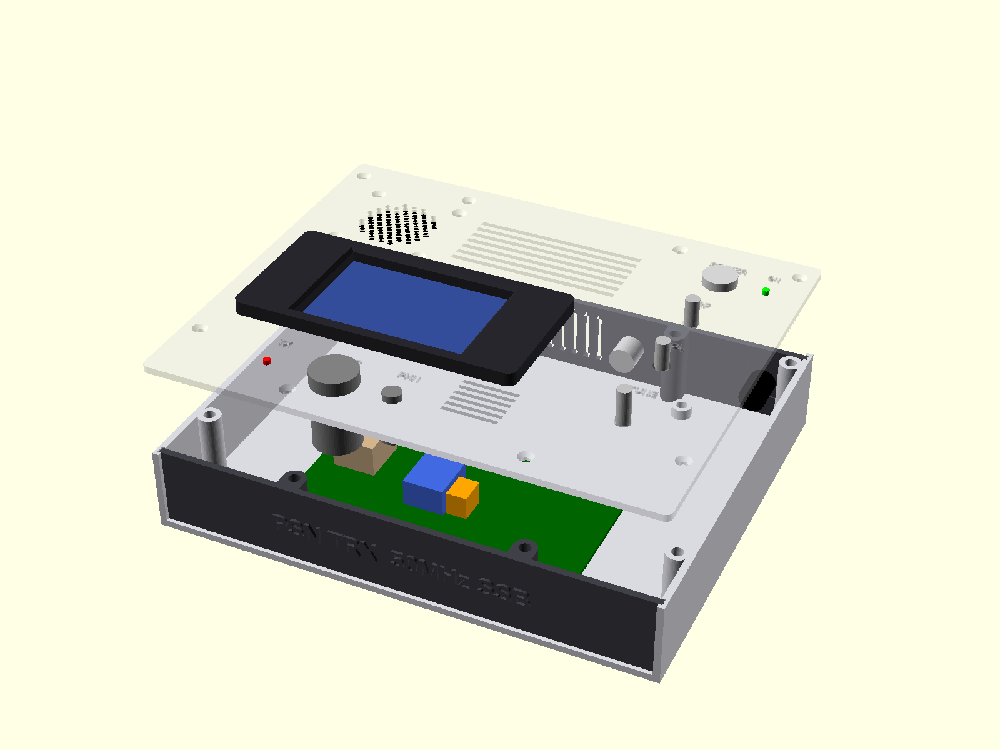
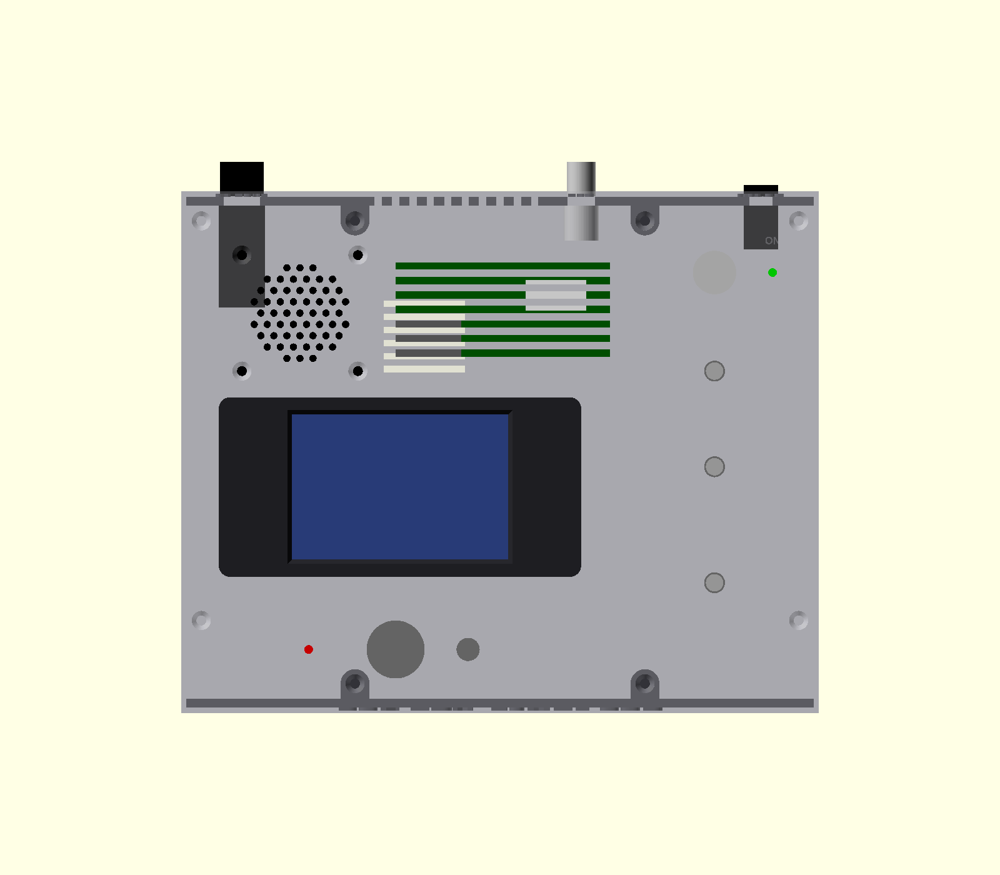

# PSN_TRX ケース（OpenSCAD）

`psn_trx_case.scad` は PSN_TRX V2 基板（134.0 × 129.63 mm、M3 取付穴 4 か所）を収めるケースのパラメトリックモデルです。



## 構成と外形

| mode | 部品 | 出力ファイル（[出力方法](#出力方法mode-番号)で作る） | 印刷の向き・寸法 | 備考 |
|---|---|---|---|---|
| 1 | ベース（底板＋左右側板） | `stl/1_base.stl` | そのまま／220×180×37 mm | 基板スタンドオフ 5 mm（インサート下穴 φ5）、ふた固定ボス 4 本、パネル差し込み溝、パネル一体ボス用の皿穴 4 か所（底面）、底面通風、ゴム足座ぐり |
| 2 | ふた | `stl/2_lid.stl` | 外面を上／220×180×4.2 mm | 上面に LCD 切り欠き・TUNE・VOL・RF・POWER・電源 LED・TX LED・MIC・PHN、後ろ寄り（Y 123〜155.5 mm、X 74〜148 mm）に通風スロット 7 本、その左にスピーカーの放音穴（φ2.5、直径 35 mm の範囲に六角配置）と取付穴 4 か所（M3 皿もみ、40 mm 角）。裏面はリブなしの平板（PHN 穴の周り 15×15 mm だけ裏から深さ 1.2 mm 掘り、板厚 1.8 mm。ジャックのねじ長さ対策）。M3×10 × 8 本で固定（側板内側のボス 4 本と、前面・後面パネル一体のボス 4 本） |
| 3 | 前面パネル | `stl/3_front_panel.stl` | 上端を下にして立てる／216.6×14.4×35.1 mm | 機種名のエンボス（1.2 mm）、内面にボス 2 本（左右の側面から 60 mm、上下にインサート）一体、サポート不要 |
| 4 | 後面パネル | `stl/4_rear_panel.stl` | 上端を下にして立てる／216.6×14.4×35.1 mm | DC ジャック・BNC・ヒューズホルダと通風スロット、エンボス表示、内面にボス 2 本一体、サポート不要 |
| 9 | LCD ベゼル | `stl/9_lcd_bezel.stl` | 表を下（ボスが上）／125×62×10 mm | 表示窓（表側 45° 面取り）、LCD 用ボス 4・ベゼル固定用インサート 4 |

印刷用（mode 1〜4, 9）はすべて Z=0 のベッド面上に置いてあり、サポートなしで印刷できる向きにしてあります。つまみはモデルに含みません（組立図ではシャフトのみ表示）。

- 外形: **幅 220 × 奥行き 180 × 高さ 40 mm**（220 mm 角のベッドで印刷できる上限。V2 基板が 21.3 mm 広くなったので 215 mm から広げた。ベゼル 6 mm は上面に出る）。基板上で最も高い放熱器 HS1（25 mm）の上端は底から約 34.6 mm、ふた裏面は 37 mm（隙間 2.4 mm、ふたの後ろ寄りに通風スロット）。
- 操作は上から: 上面の手前（LCD の中央付近）に MIC・PHN、その奥に LCD（放熱器の手前まで）。ふた裏で部品の本体が基板にかからない位置に並べています。
  - 右列（X = 184 mm）: 奥から **POWER（＋電源 LED）・RF・VOL・TUNE**
  - 手前（LCD の手前の中央付近、ふた裏の本体は基板より前）: 左から **MIC・PHN**
  - 後面: **DC 12V・ANT（BNC）・FUSE**（高さは後面の見える範囲の中央、下から約 18 mm）。ANT は基板の J1（アンテナ）のすぐ後ろ
  - 前面: 機種名のみ
- 前後パネルは厚さ 3 mm。内面にボス 2 本（外径 10 mm、内面に密着）を一体で印刷し、ベース（底板・左右側板）の溝に上から差し込んで、ボスの上端をふたに、下端を底板にねじ止めします。アルミ板で作る場合は、ボスを別に用意してください。穴あけ図は `drawings/7_front_panel_2d.dxf/.svg`・`drawings/8_rear_panel_2d.dxf/.svg`（外から見た向き、原寸 mm）。
- 文字はふた上面・前後パネルともエンボス（1.2 mm）です。ふたは外面を上にしてサポートなしで印刷できます（裏面の PHN 周りの座ぐりは 15 mm のブリッジになります）。
- 基板は右辺（LCD・エンコーダ用ヘッダ J8/J7/J9）を前面に、左辺（J1 アンテナ・J2 電源）を後面に向けて置きます。基板の左端は X 43.3 mm（放熱器をなるべく右に寄せ、左にスピーカーを入れるため中央より右）。
- 側板・ふた・底板は、前後パネルの外面より前後それぞれ 2.0 mm 長くしてあります（`overhang`）。
- ねじとインサート: スタンドオフ（高さ 5 mm）とふた固定ボス（底板から側板上端まで伸ばした柱、外径 10 mm、左右側板の内側 4 か所）、前後パネル一体のボス（前面・後面に 2 本ずつ、左右の側面から 60 mm）には M3 インサートナットを熱圧入します（下穴 φ5.0。ふた側は上端から深さ 10 mm、パネル一体ボスの底板側は下端から深さ 8 mm）。
  - 基板固定: **M3×6** × 4 本（基板 1.6 mm ＋ インサート 4.4 mm）
  - ふた固定: **M3×10** × 8 本（ふた 3 mm ＋ インサート 7 mm、皿ねじなら面一）。うち 4 本は前後パネル一体のボスに入り、パネルをふたに固定します
  - 前後パネル → 底板: **M3×10 皿ねじ** × 4 本（底板の裏から。底板 3 mm ＋ パネル一体ボスのインサート）
  - LCD → ベゼル: **M3×6** × 4 本（LCD 基板 1.6 mm ＋ ベゼルのボスのインサート）
  - ベゼル → ふた: **M3×8** × 4 本（ふた裏側から。ふた 3 mm ＋ ベゼルのインサート 5 mm）
  - スピーカー → ふた: **M3×8 皿ねじ** × 4 本＋ **M3 ナット** × 4 個（ふたの上面から差し、スピーカーの枠の裏でナット留め）

## 上面



| 部品 | 穴径 | 接続先 |
|---|---|---|
| LCD（Nextion NX4832T035、3.5インチ 480×320 シリアル HMI） | ふたは LCD 外形＋2 mm の切り欠き（102.5 × 57 mm）とベゼル固定穴 φ3.4 × 4（LCD の左右に上下 2 本ずつ）。表示窓はベゼル側（74.5 × 50 mm） | J8 |
| ロータリーエンコーダ（押しスイッチ付き） | φ7.2（M7 ブッシュ） | J7 |
| AF ボリューム（10 kΩ A） | φ7.2 | J5 |
| RF ゲイン ボリューム（5 kΩ） | φ7.2 | J4 |
| 電源スイッチ | φ13.0（丸穴） | DC ジャック → ヒューズ → スイッチ → J2 |
| 送信表示 LED（3 mm） | φ3.0。MIC の左 30 mm（X 44、Y 22 mm。MIC の穴と同じ高さ） | J3 |
| スピーカー（秋月 116024 DXYD50N-22Z-8A-F、5 cm 8 Ω 0.5 W） | 放音穴 φ2.5（直径 35 mm の範囲）、取付穴 φ3.4 × 4（40 mm 角、皿もみ）。中心 X 41、Y 138 mm、通風スロット（X 74〜148 mm）の左 | J6（SP-OUT）からイヤホンジャック（MJ-352W-C）のブレーク接点経由。イヤホンを挿すとスピーカーが切れる |
| 電源 LED（3 mm） | φ3.1（LED ホルダ使用時は 5.0 に変更）。電源スイッチの右 | スイッチ後の 12V から 2.2 kΩ 経由 |
| マイクコネクタ（4P 丸型） | φ16.2 | J10（1: +5V / 2: MIC / 3: PTT / 4: GND） |
| イヤホンジャック（3.5 mm、スイッチ付き。秋月 117359 MJ-352W-C） | φ6.2（ジャックの M6 ねじを通しナットで固定。穴の周りはふた裏から座ぐりして板厚 1.8 mm） | J6。スピーカーはジャックのブレーク接点経由でつなぐ（プラグを挿すとスピーカーが切れる） |

エンボス表示: `TUNE`、`VOL`、`RF`、`POWER`、`ON`、`TX`、`MIC`、`PHN`

**スピーカーの下の部品に注意**: スピーカーはふた裏に付き、マグネット（φ22）の下端は底から 19.5 mm（基板上面から約 10 mm）になります。マグネットの真下に来る基板の部品は C13（100 µF）と RFC1（横置き）だけで、**C13 は寝かせて付けるか高さ 7 mm 以下の品**にしてください（RFC1 はそのままでよい）。枠の下には J3・R9・Q6・VR2・L3 が来ますが、枠はふた裏に密着しているので当たりません。Q3（TO-220）と放熱器は枠の外（右）です。左のヒューズホルダ本体とは平面で 1 mm 以上離してあります。左後ろのふた固定ボスはスピーカーをかわすため、左右とも後面パネルの溝の手前（Y 169.8 mm）に置いています。

## 前面パネル


機種名 `PSN TRX 50MHz SSB`（エンボス 1.2 mm）のみです。

## 後面パネル


| 部品 | 穴径 | 備考 |
|---|---|---|
| 12V DC ジャック（パネル取付） | φ11.0 | センタープラス |
| BNC（アンテナ） | φ9.6 | 基板 J1 のすぐ後ろ（J1 の 3.6 mm 右。左の L1 をかわす）。J1 へ短い同軸で接続 |
| ヒューズホルダ（5 × 20 mm、パネル取付） | φ12.5 | 速断 1 A 目安。パネル裏に約 35 mm 出る（基板の左外に入る） |

エンボス表示: `DC 12V`、`+ CENTER`、`ANT`、`FUSE 1A`

## 注意（必ず実測してから出力）

- **LCD ベゼル（125 × 62 × 6 mm、mode 9）**: ふた上面に置き、LCD はベゼル裏のボス 4 本（M3 インサートナット）に LCD 基板の裏側から **M3×6** で固定します。ベゼルには別に 4 個のインサートナット（LCD の左右）があり、ふたの穴（φ3.4）を通して **ふた裏側から M3×8** で固定します。上面にねじ頭は出ません。
  - インサート下穴はいずれも φ5.0、前面に 1 mm 残した止まり穴（LCD 用は深さ 9 mm、ベゼル固定用は深さ 5 mm）。
- LCD は回路・ファームウェアと同じ **Nextion NX4832T035**（3.5インチ、480×320）です。外形・表示領域は Nextion の公表値（100.5 × 54.94 × 5.45 mm、表示領域 73.44 × 48.96 mm）を使っています。**表示領域の中心ずれ（`lcd_win_off`）・取付穴ピッチ（`lcd_holes`、94.5 × 48.94 mm と仮定）・ボス高さ（`lcd_boss_h` = ガラス＋ベゼル厚、4.0 mm と仮定）は推定値なので、実物を測って修正してください。**
- コネクタ・スイッチ類の穴径も実部品に合わせて調整してください（ファイル先頭のパラメータ）。
- 送信表示 LED（J3）は上面の MIC の左（`tx_c`、φ3.0、表示 `TX`）に付けます。RF ゲイン（J4）は上面の RF ボリュームにつなぎます（つまみ・本体の寸法は VOL と同じと仮定）。

## 出力方法（mode 番号）

STL ファイルはリポジトリに含めていません。印刷する前に `psn_trx_case.scad` から出力してください。

ファイル先頭の `mode = 0;` の数字を変えて F5（プレビュー）／F6（レンダリング）→「STL を出力」、またはコマンドラインで出力します（先に `stl` フォルダを作っておく）。

| mode | 内容 |
|---|---|
| 0 | 組立図（ふたを浮かせて表示） |
| 1 | ベース（3D 印刷用） |
| 2 | ふた（3D 印刷用） |
| 3 | 前面パネル（3D 印刷用） |
| 4 | 後面パネル（3D 印刷用） |
| 5 | 組立図（ふたを閉じた状態） |
| 6 | ふたなし内部 |
| 7 | 前面パネル穴あけ図（2D：DXF/SVG） |
| 8 | 後面パネル穴あけ図（2D：DXF/SVG） |
| 9 | LCD ベゼル（3D 印刷用） |

```sh
mkdir -p stl
openscad -o stl/1_base.stl         -D mode=1 psn_trx_case.scad
openscad -o stl/2_lid.stl          -D mode=2 psn_trx_case.scad
openscad -o stl/3_front_panel.stl  -D mode=3 psn_trx_case.scad
openscad -o stl/4_rear_panel.stl   -D mode=4 psn_trx_case.scad
openscad -o stl/9_lcd_bezel.stl    -D mode=9 psn_trx_case.scad
openscad -o drawings/7_front_panel_2d.dxf -D mode=7 psn_trx_case.scad
openscad -o drawings/8_rear_panel_2d.dxf  -D mode=8 psn_trx_case.scad
```
