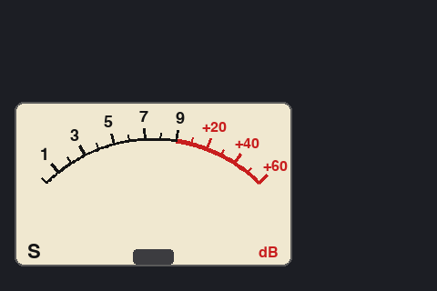

# PSN_TRX 操作説明書

50MHz 帯 PSN 方式 SSB トランシーバー（XIAO ESP32C3 + Si5351 VFO）の使い方をまとめた操作説明書です。
部品の取り付けは [`docs/PSN_TRX_部品実装図.pdf`](../docs/PSN_TRX_部品実装図.pdf)（ブロック別）、調整は [`調整手順.md`](調整手順.md) を参照してください。


---

## 1. 主な仕様

| 項目 | 内容 |
|---|---|
| 周波数範囲 | 50.000 〜 51.000 MHz（6m バンド） |
| 電波型式 | SSB（PSN 方式） |
| 送信出力 | 約 1 W（12 V 時、終段 RD06HVF1） |
| 周波数ステップ | 10 Hz / 100 Hz / 1 kHz / 10 kHz / 100 kHz |
| 周波数表示 | 3.5 インチ LCD Nextion NX4832T035（480×320、Nextion シリアル HMI） |
| 周波数記憶 | 最後に使った周波数・ステップ・AGC を自動で保存（電源を切っても保持、RIT は電源を入れると 0） |
| RIT | ±9.99 kHz（10 Hz 刻み）、送信中は自動で外す |
| S メーター・AGC | 受信音の強さから S メーター表示、AGC は FAST / SLOW / OFF（基板 Ver 1.3 以降） |
| 電源 | DC 12 V（センタープラス）、ヒューズ 1 A |
| アンテナ | 50 Ω、BNC |
| 外形 | 幅 220 × 奥行き 180 × 高さ 40 mm（ベゼル・つまみ等の突起部を除く） |

---

## 2. 各部の名称

### 2.1 上面（操作部）

表示・操作とマイク・イヤホンは上面にあります。LCD は左前、右の列に前から TUNE・VOL・RF・POWER（POWER の右に ON ランプ）、左の列（LCD の後ろ）に前から MIC・PHN が並び、左奥（通風スロットの左）に TX ランプがあります。


| 表示 | 名称 | はたらき |
|---|---|---|
| （ベゼルの表示窓） | LCD（Nextion NX4832T035） | 周波数・ステップ・機種名・S メーター・AGC・RIT を表示（送信中は ALC メーター） |
| TUNE | チューニングダイヤル（ロータリーエンコーダ） | 回すと周波数が変わる。押すと設定モード（RIT・STEP・AGC）に入る |
| VOL | 音量ボリューム | イヤホンの音量を調整 |
| RF | RF ゲインボリューム | 受信感度（上限）を調整。右いっぱいで最大感度。AGC はこの位置を上限に働く |
| POWER | 電源スイッチ | 電源の入／切 |
| ON | 電源ランプ（3 mm LED） | 電源が入っていると点灯 |
| TX | 送信ランプ（3 mm LED） | 送信中に点灯 |
| MIC | マイクコネクタ（4ピン） | PTT 付きマイクを接続 |
| PHN | イヤホン端子（3.5 mm） | イヤホン・ヘッドホン・外部スピーカーを接続 |

前面パネルは機種名だけです。

### 2.2 後面パネル


| 表示 | 名称 | はたらき |
|---|---|---|
| ANT | アンテナ端子（BNC） | 50 Ω のアンテナまたはダミーロードを接続 |
| DC 12V | 電源端子 | DC 12 V を接続（センタープラス） |
| FUSE 1A | ヒューズホルダ | 5 × 20 mm、速断 1 A |

### 2.2.1 左側面


左側面にも後面と同じ電源端子（DC 12V、センタープラス）があります。中でつながっているので、使いやすいほうに電源をつないでください。**後面と左側面の両方に同時に電源をつながないでください。**

### 2.3 マイクコネクタのピン配置

| ピン | 信号 | 説明 |
|---|---|---|
| 1 | +5 V | コンデンサマイク・アンプ付きマイク用の電源（不要なら未接続） |
| 2 | MIC | マイク信号（本体からバイアス供給あり。エレクトレット／ダイナミック両対応） |
| 3 | PTT | GND に落とすと送信 |
| 4 | GND | グランド |

---

## 3. 接続

1. 電源スイッチ（POWER）が切れていることを確認します。
2. 後面の **ANT** にアンテナを接続します。初めて使うとき・調整中は 50 Ω のダミーロードを接続してください。
3. 上面の **MIC** に PTT 付きマイクを接続します。
4. 上面の **PHN** にイヤホンを接続します。
5. 後面の **DC 12V** に安定化電源（12 V、1 A 以上）を接続します。極性はセンタープラスです。

> アンテナをつながずに送信しないでください。終段トランジスタが壊れるおそれがあります。

---

## 4. 基本操作

### 4.1 電源を入れる・切る

- **POWER** を入れると **ON** ランプが点灯し、すぐに LCD に前回の周波数とステップが表示されます。
- 切るときは **POWER** を切ります。周波数とステップは自動で保存されているので、特別な操作は不要です。

### 4.2 表示の見かた

```
┌──────────────────────────────────────────┐
│ 50.150.000 MHz                           │ ← 周波数（MHz.kHz.Hz、送信周波数）
│ STEP: 1kHz                    RIT +0.25k │ ← 周波数ステップ・RIT（RIT 0 のときは表示なし）
│ ╭─────────────────────────╮          S7  │ ← S メーター値
│ │  1  3  5  7  9 +20 +40 +60│    AGC FAST │ ← AGC（送信中は TX）
│ │        ╲  （針）          │   AGC -12dB │ ← AGC で下げた感度（AGC OFF・送信中は表示なし）
│ │ S                     dB │  6m PSN TRX │ ← 機種名
│ ╰─────────────────────────╯             │
└──────────────────────────────────────────┘
```

S メーターはアナログメーターです（9 から右の赤い目盛りは S9 を超えた分の dB）。送信中は ALC メーターになります（4.8 参照）。

### 4.3 周波数を合わせる（TUNE）

- ダイヤルを **右に回すと周波数が上がり**、**左に回すと下がります**（逆になる場合はエンコーダの A・B 線を入れ替えてください）。
- 1 クリックで変わる量は、表示されている **STEP** の値です。
- 周波数は 50.000 〜 51.000 MHz の範囲で止まり、範囲外には出ません。

### 4.4 設定モード（PUSH）

RIT・周波数ステップ・AGC は、ダイヤルを押して入る **設定モード** で変えます。

```
通常（ダイヤル = 周波数）
   │ 押す
   ▼
設定モード「MENU > RIT」（ダイヤルで RIT → STEP → AGC → EXIT を選ぶ）
   │ 押す
   ▼
値の変更「> RIT: +0.25kHz [PUSH=OK]」（ダイヤルで値を変える）
   │ 押す
   ▼
確定して通常に戻る
```

- 設定モード・値の変更の途中で **長押し（0.8 秒）** するか、**15 秒** 操作しないと、変更を取り消して通常に戻ります。
- 設定モードで **EXIT** を選んで押しても通常に戻ります。
- 表示は STEP の行（t1）が「MENU > …」や「> …  [PUSH=OK]」に変わります。

| 機能 | ダイヤルで変わるもの | 記憶 |
|---|---|---|
| RIT | 受信周波数のずれ（10 Hz 刻み、−9.99 〜 +9.99 kHz）。回すとすぐに受信音が変わるので、聞きながら合わせる | 電源を切ると 0 に戻る |
| STEP | 周波数ステップ 10Hz → 100Hz → 1kHz → 10kHz → 100kHz | 記憶する |
| AGC | AGC FAST → AGC SLOW → AGC OFF | 記憶する |

### 4.5 RIT（受信周波数だけをずらす）

相手局の周波数が少しずれているとき、送信周波数はそのままで受信周波数だけを合わせます。

1. ダイヤルを押し（MENU > RIT）、もう一度押します。
2. ダイヤルを回して、相手の声が自然に聞こえるところに合わせます。
3. 押すと確定し、LCD に **RIT +0.25k** のようにずれが表示されます。

- 表示している周波数は **送信周波数** です。受信はそれに RIT を足した周波数になります。
- 送信中（PTT を押している間）は RIT を外し、表示どおりの周波数で送信します。PTT を離すと RIT のずれた周波数で受信に戻ります。
- RIT をやめるときは、**通常の状態でダイヤルを長押し（0.8 秒）** すると 0 に戻ります（設定モードで 0 に合わせても同じ）。
- PTT を押した直後のごく短い時間（数 ms）は RIT がかかったままの周波数で出ます。音声の SSB ではほぼ影響ありません。

### 4.6 受信する

1. 周波数を合わせ、**VOL** で聞きやすい音量にします。
2. SSB の信号は、周波数が少しずれると高い声・低い声になります。STEP を 100 Hz または 10 Hz にして、自然な声になるところに合わせます。

> 受信感度は上面の **RF** つまみで調整します。通常は右いっぱい（最大感度）で使い、強い局で音がひずむときや雑音が多いときに少し絞ります。AGC はこの RF つまみで決めた感度を上限に、強い信号のときだけ感度を下げます。

### 4.7 AGC

AGC は設定モードの **AGC** で切り替えます（4.4 参照）。

| 表示 | はたらき |
|---|---|
| AGC FAST | 強い信号で下げた感度を速く戻す（通常の交信向け） |
| AGC SLOW | ゆっくり戻す（強い局が続けて話すとき、音量の上下を抑えたいとき） |
| AGC OFF | AGC を止める（感度は RF つまみで決めた値のまま） |

- S メーターは受信音の強さと AGC で下げた量から計算した目安です。RF つまみを右いっぱい（最大感度）にしたときに一番正確になります。
- 送信中は AGC を止め、表示は **TX** になります。

### 4.8 送信する

1. 送信しようとする周波数が空いていることを、受信して確認します。
2. マイクの **PTT** を押すと送信状態になります（内部のリレーが「カチッ」と切り替わります）。
3. マイクに向かって普通の声で話します。マイクに近づきすぎると音がひずみます。
4. PTT を離すと受信に戻ります。

- 送信中も周波数表示は消えません。
- 送信中はダイヤルを回さないでください（送信周波数が変わります）。
- RIT を使っているときも、送信は表示どおりの周波数で行われます。

**ALC メーター**: 送信中はメーターがマイク入力の強さを示し、S メーター値の場所に **ALC 6dB** のように ALC が絞った量が出ます。

- 針が 9 の位置で ALC が効き始めます。赤い目盛り（+20 など）の範囲に入った分だけ、ALC が自動で音量を下げてひずみを防ぎます。
- 話したときに針が **9 の付近から少し赤い目盛りに入る** くらい（ALC 0〜10dB）が適当です。いつも大きく振り切れるときはマイクから少し離れるか、マイク利得（7 章の `mic`）を下げます。
- ALC は送信音声をデジタルで処理するもので、送信出力（RF）を測っているわけではありません。

---

## 5. 使用上の注意

- 送信には **アマチュア無線局の免許** が必要です。電波法・バンドプランに従って運用してください。
- 使用中は放熱のため、ふた・底面の通風穴をふさがないでください。長時間の送信では終段の放熱器が熱くなります。
- 電源は 12 V（10.5 〜 13.8 V 程度）で使用してください。逆接続やそれ以上の電圧は故障の原因になります。
- ヒューズが切れたときは、原因を調べてから同じ定格（1 A）のヒューズに交換してください。
- 濡れた手で操作しないでください。屋外で使うときは雨・結露に注意してください。

---

## 6. 困ったときは

| 症状 | 確認すること |
|---|---|
| 電源が入らない（ON ランプが消えている） | 12 V が来ているか、極性（センタープラス）、ヒューズが切れていないか |
| LCD が表示されない | LCD の配線（J8）、+5 V が出ているか（基板の IC1 出力） |
| 周波数が変わらない | エンコーダの配線（J7）。設定モード中（STEP の行が MENU や [PUSH=OK] になっている）なら、長押しで通常に戻る |
| 受信と送信で周波数がずれる | RIT がかかっていないか（LCD に RIT 表示）。通常の状態で長押しすると 0 に戻る |
| 音が出ない | 音量（VOL）、イヤホンの差し込み、アンテナの接続 |
| 受信感度が低い | RF つまみ（右いっぱいが最大感度）、アンテナ、同調コイル（L2・L4・L9）の調整 |
| PTT を押しても送信にならない | マイクのピン配置（3 番が PTT、4 番が GND）、リレー K1 の動作音 |
| 送信出力が出ない・弱い | アンテナ／ダミーロード、Idq（VR2）、出力 LPF（TC1）・同調コイル（L6〜L8）の調整 |
| 相手に聞こえる音がこもる・不要な側波帯が出る | キャリアバランス（VR3/VR4）、キャリアレベル（VR6/VR7）、I/Q の補正（`iqd`・`iqa`）の調整。手順は [送信 I/Q の調整手順](送信IQ調整手順.md) |
| S メーターが振れない・AGC が効かない | 基板 Ver 1.3 以降か（Ver 1.2 以前は非対応）、LCD の背景画像（ピクチャ 0）と t3・t4 があるか、スケッチの調整値（7 章） |
| AGC の量（AGC -12dB）が出ない | LCD の画面に t6 があるか（7 章） |
| 電源を入れるたびに周波数が 50.500 MHz に戻る | 周波数の保存（NVS）に失敗している。ファームウェアの書き込み直し |

調整方法は [`docs/PSN_TRX_組み立て説明書.docx`](../docs/PSN_TRX_組み立て説明書.docx) の「7. 調整手順」を参照してください。

---

## 7. ファームウェア

| 項目 | 内容 |
|---|---|
| スケッチ | [`PSN_TRX_XIAO_ESP32C3/PSN_TRX_XIAO_ESP32C3.ino`](../PSN_TRX_XIAO_ESP32C3/PSN_TRX_XIAO_ESP32C3.ino) |
| 開発環境 | Arduino IDE、ボード「XIAO_ESP32C3」 |
| ライブラリ | Etherkit Si5351（Adafruit SSD1306 / GFX は OLED 使用時のみ） |
| 書き込み | ケースのふたを開け、XIAO の USB-C にパソコンを接続して書き込む |

- 表示器は `#define USE_NEXTION_DISPLAY`（標準）で Nextion LCD、コメントアウトすると SSD1306 OLED になります。
- LCD の画面データ（t0 = 周波数、t1 = ステップ、t2 = 機種名、背景のピクチャ 0 = S メーターの目盛り、t3 = S メーターの値、t4 = AGC 状態、t5 = RIT、t6 = AGC の量）は Nextion Editor で NX4832T035（480×320）の画面として作成し、LCD に書き込んでおきます。
- LCD の画面配置（480×320、周波数は 32 ドット、ほかは 24 ドットのフォント）は次のとおりです。S メーターはアナログメーターで、目盛りは背景画像、針はスケッチが描きます。

  

  1. Nextion Editor でピクチャ 0 として [`nextion/background.png`](../PSN_TRX_XIAO_ESP32C3/nextion/background.png) を取り込み、page0 の背景を **sta = image、pic = 0** にします（画像は [`nextion/make_background.py`](../PSN_TRX_XIAO_ESP32C3/nextion/make_background.py) で作れます）。
  2. Font Generator で半角英数だけの 24 ドット（フォント 0）と 32 ドット（フォント 1）を作ります。
  3. 下の表のとおりテキスト部品を置きます。テキスト部品は **sta = crop image（picc = 0）** にすると背景になじみます（単色にする場合は bco = 6372）。メーター面（x 16〜320、y 112〜292）には部品を置かないでください。

  | 部品 | x | y | 幅 | 高さ | フォント | txt_maxl | 内容 |
  |---|---|---|---|---|---|---|---|
  | t0 | 16 | 16 | 448 | 40 | 1（32 ドット） | 16 | 周波数 |
  | t1 | 16 | 72 | 320 | 32 | 0（24 ドット） | 32 | STEP（設定モード中はメニュー・設定値） |
  | t5 | 344 | 72 | 120 | 32 | 0 | 12 | RIT（右寄せ） |
  | （メーター面） | 16 | 112 | 305 | 181 | — | — | 背景画像の目盛り。針はスケッチが描く |
  | t3 | 344 | 120 | 120 | 32 | 0 | 8 | S メーター値（S7、S9+20 など。送信中は ALC が絞った量: ALC 6dB、ALC OFF） |
  | t4 | 344 | 168 | 120 | 32 | 0 | 12 | AGC 状態（送信中は赤い TX。文字色はスケッチが切り替える） |
  | t6 | 344 | 208 | 120 | 32 | 0 | 12 | AGC の量（AGC -12dB。AGC OFF・送信中は空欄） |
  | t2 | 344 | 256 | 120 | 32 | 0 | 12 | 機種名 |

  > **画面データ（.HMI）について**
  > - 画面データは [`nextion/PSN_TRX.tft`](../PSN_TRX_XIAO_ESP32C3/nextion/PSN_TRX.tft)（LCD に書き込むファイル）と [`nextion/PSN_TRX.HMI`](../PSN_TRX_XIAO_ESP32C3/nextion/PSN_TRX.HMI)（Nextion Editor で編集する元ファイル）です。.tft を microSD に入れて LCD に書き込めばそのまま使えます。作り方と書き込み方は [`nextion/画面データ作成手順.md`](../PSN_TRX_XIAO_ESP32C3/nextion/画面データ作成手順.md) を見てください。
  > - **t6（AGC の量）は 2026-10-21 のファームウェアから使っています。** それより前に作った画面データには t6 がないので、上の表のとおり追加して LCD に書き込み直してください（t6 がなくても AGC の量が出ないだけで、ほかの表示は動きます）。
  > - 見た目が同じ TJC の LCD（TJC4832T135 など）は、エディタと画面データに互換性がないので、この画面データは使えません。TJC4832T135 用の画面データ [`nextion/PSN_TRX_TJC.tft`](../PSN_TRX_XIAO_ESP32C3/nextion/PSN_TRX_TJC.tft)（元ファイル `PSN_TRX_TJC.HMI`、USART HMI で編集）を書き込めば、スケッチは変えずに使えます（[`nextion/画面データ作成手順.md`](../PSN_TRX_XIAO_ESP32C3/nextion/画面データ作成手順.md) の 9 章）。
  > - Nextion Editor のシミュレータ（Debug）で表示を確かめる場合も、画面データに t6 が必要です。

  送信中はメーターの針がマイク入力のピークを示します（ALC の効き始め = S9 の位置、赤い +dB の目盛り = ALC が絞った量）。LCD との通信は起動時にスケッチが 9600bps から 115200bps に切り替えます（LCD の設定は変えない）。

- S メーター・AGC の調整値はスケッチ冒頭の `SMETER_S9_DBFS`（S9 の信号のときの受信音レベル）、`AGC_TARGET_DBFS`（AGC が効き始めるレベル）、`AGC_DUTY_START` / `AGC_DUTY_FULL`（Q17 が効き始める／G2 をほぼ 0V まで下げる PWM 値）です。シリアルモニタ（115200bps）に 0.1 秒ごとに `lvl`（受信音レベル）・`agc`（AGC の量）・`S` が出るので、それを見て合わせます。
- ALC（送信音声のデジタル ALC）の効き始めはシリアルのコマンド `alc <dBFS>`（-24〜0、標準 -20。2026-10-27 以前のスケッチは -6）で変え、`alc off` で止めます。`w` で保存します。マイク利得 `mic` を上げすぎても、ALC が効き始めのレベルで抑えるので変調器の入力が過大になりません。
- 基板 Ver 1.2 以前ではエンコーダのスイッチが D2 につながっています。そのまま使う場合はスケッチの `ENC_SW` を `D2` に戻してください（S メーター・AGC は使えません）。
- 送信の側波帯（USB/LSB）が逆になる場合は、シリアルのコマンド `sb lsb`（または `sb usb`）で入れ替え、`w` で保存します。
- 不要側波帯を減らす調整（試験トーン `tone`、I/Q の補正 `iqd`・`iqa`）は [送信 I/Q の調整手順](送信IQ調整手順.md) を見てください。

---

## 関連資料

- [送信 I/Q の調整手順](送信IQ調整手順.md)（不要側波帯の抑圧、基板 Ver 2.0）
- [組み立て説明書](../docs/PSN_TRX_組み立て説明書.docx)
- [部品実装図](../docs/PSN_TRX_部品実装図.pdf)
- [VFO 改造仕様書](../docs/PSN_TRX_VFO改造仕様書.docx)
- [ケース（OpenSCAD）](../enclosure/README.md)
