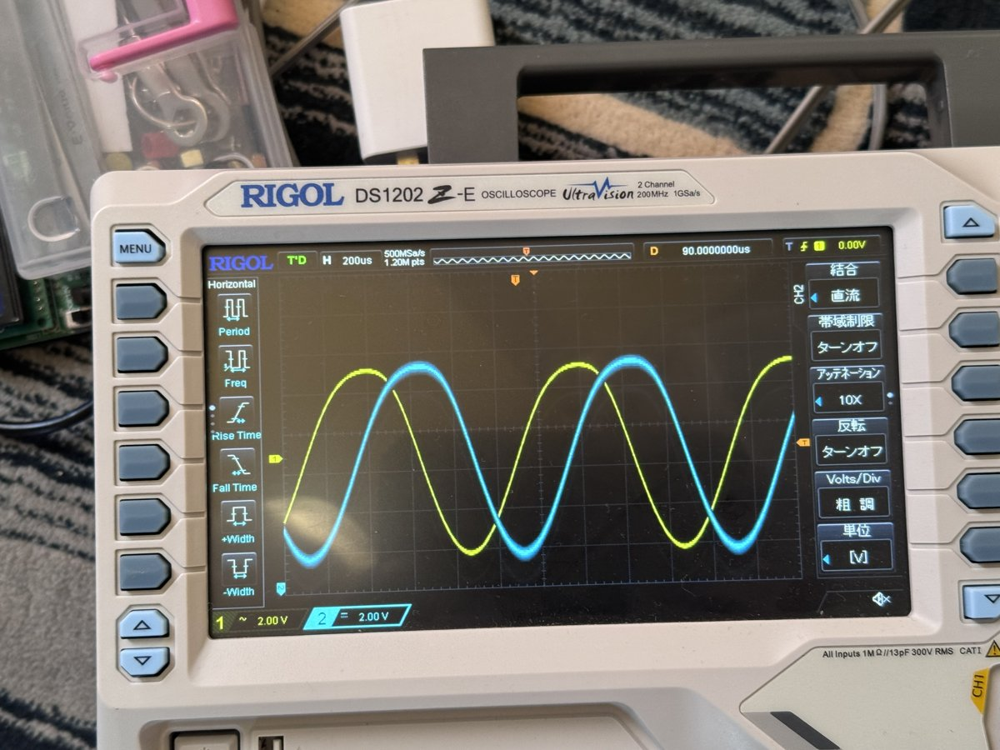
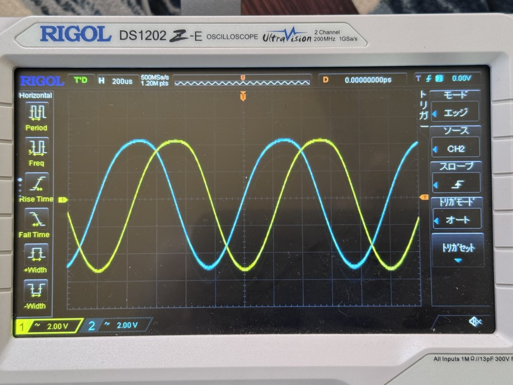
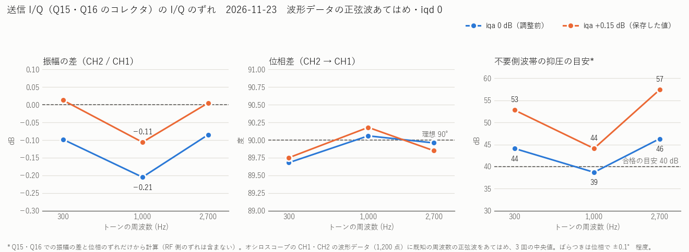

# 送信 I/Q（PDM → Q15・Q16）の波形確認の記録（2026-11-23）

V2 の基板で、XIAO ESP32C3（U7）が作る送信の I/Q 信号が、PDM 出力（D8・D10）→ 2 段 RC → Q15・Q16 のコレクタまで正しく出ることを、試験トーンとオシロスコープで確かめた記録です。ドライブ段（Q18）と終段（Q19）は付けていない状態で測りました（電波は出ません）。

## 1. 条件

| 項目 | 値 |
|---|---|
| 基板 | V2（ドライブ段 Q18・終段 Q19 は未実装） |
| ファームウェア | V2 の main（2026-11-23 の修正入り。下の 4 章）、ESP32 Arduino コア 3.3.12 |
| 設定（USB シリアルのコマンド） | `tone 500` → `tone 1000`（試験トーン）、`out 100`（出力 100 %）。ALC は -20 dBFS から（初期値）、USB |
| オシロスコープ | RIGOL DS1202Z-E、付属プローブ 10X |
| 測った点 | CH1・CH2 = Q15・Q16 のコレクタ（C71・C73 の手前） |

`tone` と `out` は保存していないので、電源を入れ直すと元に戻ります（トーンなし、出力は保存値）。

## 2. 信号の経路

```
XIAO D8（Q の PDM）─ R55 3.3k ─┬─ R56 3.3k ─┬─ C72 1µ ─ Q16 ベース（R59 1M で自己バイアス）
                               C68 3300p     C69 3300p
XIAO D10（I の PDM）─ R53 3.3k ─┬─ R54 3.3k ─┬─ C70 1µ ─ Q15 ベース（R57 1M で自己バイアス）
                                C66 3300p     C67 3300p
TX12V ─ R61 4.7k ─ Q16 コレクタ（エミッタ R58 22Ω）
TX12V ─ R62 4.7k ─ Q15 コレクタ（エミッタ R60 22Ω）
```

## 3. 結果

| 測った点 | 結果 |
|---|---|
| D8・D10 の信号（ファームウェアで GPIO マトリクスを読む、`dsp`） | 送信中は D8 = 15（I2S PDM 1 本目 = Q）、D10 = 59（PDM 2 本目 = I）。受信中の D10 は AGC の PWM |
| R53 と R54 の間（I 側、1 段目の RC の後） | 500 Hz の正弦波 約 0.2 V p-p（ALC で全体の約 10 % に絞った分） |
| Q16 のコレクタ（DC） | 7.5 V（R61 に約 1 mA） |
| Q15・Q16 のコレクタ（500 Hz） | 2 つともきれいな正弦波、約 90° ずれ（写真 1） |
| Q15・Q16 のコレクタ（1 kHz、両方 AC 結合） | 約 9.5 V p-p と 9.7 V p-p（差 0.2 dB 以下）、位相差 約 90°、ひずみ・クリップなし（写真 3） |

- 写真 2（1 kHz）は CH2 が DC 結合、CH1 が AC 結合のままだったので、大きさに 1 割ほどの差が見えています。両方を AC 結合にそろえた写真 3 では差はほとんどありません。
- 写真 1・2 と写真 3 で、黄・青の進み遅れが逆なのはプローブのつなぎ替えによるものです（どちらの写真でも位相差は約 90°）。
- 約 9.5 V p-p は、コレクタの中心 7.5 V・電源 12 V から見て、波形がつぶれずに出せる上限に近い大きさです。

| 写真 1: 500 Hz | 写真 2: 1 kHz（CH2 は DC 結合） | 写真 3: 1 kHz（両方 AC 結合） |
|---|---|---|
|  |  |  |

### 3.1 3 つの周波数での I/Q のずれと iqd・iqa の調整

DS1202Z-E を LAN（SCPI、ポート 5555）でつなぎ、試験トーンを 300 Hz・1,000 Hz・2,700 Hz（I/Q を作るフィルタの範囲の両端と中央）に切り替えて測りました。出力 100 %、ALC -20 dBFS、両チャンネル AC 結合。

**測り方**: オシロスコープの CH1・CH2 の画面の波形データ（各 1,200 点、`:WAV:DATA?`）を取り込み、既知のトーンの周波数の正弦波を最小二乗であてはめて振幅と位相を出す（[`docs/tools/scope_iq_fit.py`](../docs/tools/scope_iq_fit.py)、3 回の中央値、ばらつきは位相で ±0.1° 程度）。オシロスコープの位相の測定機能（`:MEAS:ITEM? RPH`）は、同じ波形で 85〜89° と数度ずれ、最大 4° ばらつくので、1° 以下の評価には使えない（最初にこれで測った「87〜89°」は誤り）。

**iqd（I/Q の遅延補正）を変えたときの位相差（CH2 → CH1、iqa 0）**

| iqd | 300 Hz | 1,000 Hz | 2,700 Hz |
|---|---|---|---|
| −4 µs | 90.15° | 91.56° | 93.82° |
| −2 µs | 89.93° | 90.83° | 91.87° |
| **0 µs** | **89.68°** | **90.06°** | **89.96°** |
| +2 µs | 89.57° | 89.39° | 87.94° |
| +4 µs | 89.29° | 88.66° | 86.07° |

iqd 0 で 3 つとも 90° ± 0.3° 以内。iqd は 0 のままがよい（2,700 Hz で 1 µs あたり約 0.9°、計算どおり 360°×f×τ で動く）。

**iqa（I/Q の利得補正）を変えたときの振幅の差（CH2 / CH1）と位相差（iqd 0）**

| iqa | 300 Hz | 1,000 Hz | 2,700 Hz | 抑圧の目安*（300 / 1,000 / 2,700 Hz） |
|---|---|---|---|---|
| 0 dB | −0.10 dB / 89.68° | −0.21 dB / 90.06° | −0.09 dB / 89.96° | 44 / 39 / 46 dB |
| +0.10 dB | −0.02 dB / 89.71° | −0.14 dB / 90.06° | −0.01 dB / 89.82° | — |
| **+0.15 dB** | **+0.01 dB / 89.75°** | **−0.11 dB / 90.18°** | **+0.01 dB / 89.85°** | **53 / 44 / 57 dB** |
| +0.20 dB | +0.08 dB / 89.66° | −0.06 dB / 90.06° | +0.06 dB / 89.78° | — |

\* ここ（Q15・Q16 のコレクタ）の振幅の差と位相のずれだけから計算した不要側波帯の抑圧の目安。実際の送信では RF 側（平衡変調器・合成）のずれも加わる。



- **iqd 0・iqa +0.15 dB・出力 10 % を `w` で保存した**（出力は試験の 100 % から 10 % に戻してから保存）。この点での抑圧の目安は 3 つの周波数とも 44 dB 以上。
- 1,000 Hz だけ振幅の差が残るのは、1 kHz の振幅（約 9.8 V p-p）がコレクタで出せる上限に近く、片方がわずかにつぶれ始めているためと考えられる（300 Hz・2,700 Hz は約 8.4 V p-p）。
- 振幅は 1 kHz が最大で、300 Hz・2,700 Hz は 1 割ほど小さい（PDM の後の RC とデジタルの I/Q フィルタの周波数特性）。どれもクリップなし（XIAO の `dsp` のクリップも 0）。
- 送信回路を組んだあとは、RF 側のずれを VR3・VR4 と iqa で合わせる（iqd はたぶん 0 のまま）。

オシロスコープの画面（測定機能の表示は参考。位相の値は上の理由で不正確）:

| 300 Hz | 1,000 Hz | 2,700 Hz |
|---|---|---|
|  |  |  |

逆側帯波の抑圧の最終調整（`iqa`・`iqd`・VR3・VR4）は、送信回路を組んでから [`送信IQ調整手順.md`](送信IQ調整手順.md) で行います。

## 4. この確認の途中で直したファームウェアの不具合

| 症状 | 原因 | 直し方 |
|---|---|---|
| PTT を押すと XIAO が止まって再起動する（`intr_alloc: No free interrupt inputs for DMA_CH0`） | ESP32-C3 の GDMA は送受信が組になっていて割り込みは組ごとに 1 本。ADC（受信方向）と I2S（送信方向）が同じ 0 番の組に入り、割り込みを取り合った | 起動時に空の GDMA 受信チャネルで 0 番の組を押さえてから ADC を始め、ADC を 1 番の組に回す（`tx_dsp.cpp` の `dspBegin`） |
| 送信中に PDM が出ない（送信ブロックが 0 のまま） | 上の不具合を最初は「I2S を先に作る」方法で直したところ、ADC が 1 回も読めなくなった | 上の GDMA の方法に変えた |
| AGC の PWM が出ていない（`ledc: requested frequency 19500 and duty resolution 12 can not be achieved`） | ESP32-C3 の LEDC の初期のクロックが XTAL（40 MHz）で、12 ビットでは約 9.8 kHz までしか出せない | LEDC のクロックを APB（80 MHz）に（`ledcSetClockSource`） |
| PTT から LCD の TX 表示まで数秒かかる（USB をつないで PC で読んでいないとき） | USB シリアルへの書き込みで待たされていた | `Serial.setTxTimeoutMs(0)` |

`dsp` コマンドの表示に、ADC の読み取り回数・失敗回数と、D8・D10 に出している信号の番号を足しました（診断用）。
