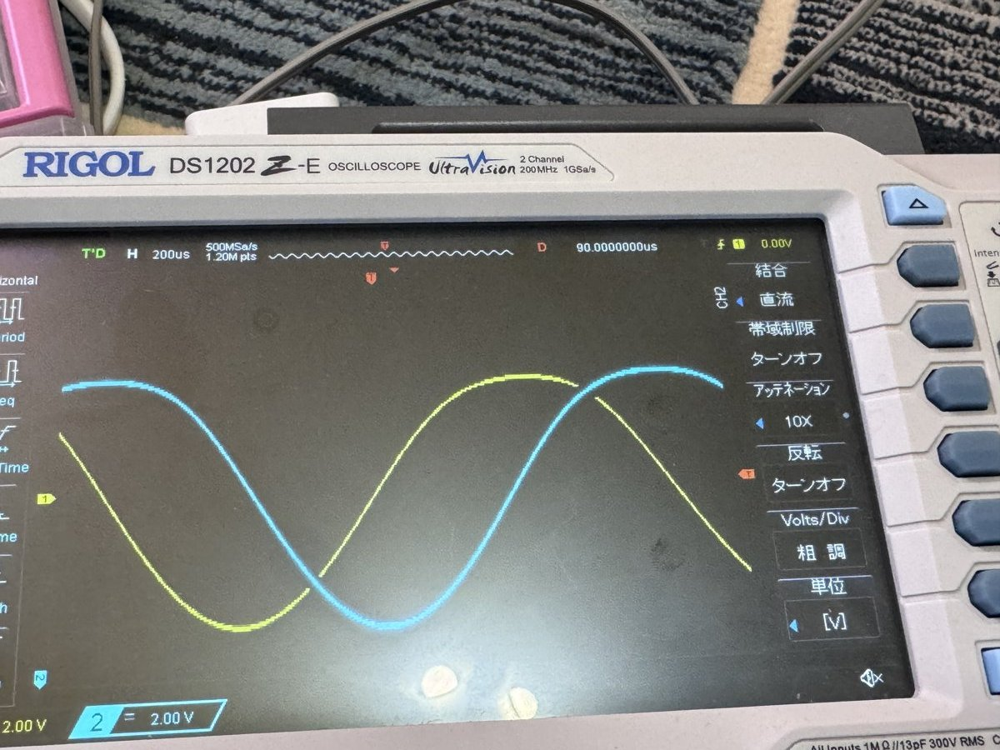

# 送信 I/Q（PDM → Q15・Q16）の波形確認の記録（2026-11-23）

V2 の基板で、XIAO ESP32C3（U7）が作る送信の I/Q 信号が、PDM 出力（D8・D10）→ 2 段 RC → Q15・Q16 のコレクタまで正しく出ることを、試験トーンとオシロスコープで確かめた記録です。ドライブ段（Q18）と終段（Q19）は付けていない状態で測りました（電波は出ません）。

## 1. 条件

| 項目 | 値 |
|---|---|
| 基板 | V2（ドライブ段 Q18・終段 Q19 は未実装） |
| ファームウェア | V2 の main（2026-11-23 の修正入り。下の 4 章）、ESP32 Arduino コア 3.3.12 |
| 設定（USB シリアルのコマンド） | `tone 500` → `tone 1000`（試験トーン）、`out 100`（出力 100 %）。ALC は -20 dBFS から（初期値）、USB |
| オシロスコープ | RIGOL DS1202Z-E、付属プローブ 10X |
| 測った点 | CH1・CH2 = Q15・Q16 のコレクタ（C71・C73 の手前） |

`tone` と `out` は保存していないので、電源を入れ直すと元に戻ります（トーンなし、出力は保存値）。

## 2. 信号の経路

```
XIAO D8（Q の PDM）─ R55 3.3k ─┬─ R56 3.3k ─┬─ C72 1µ ─ Q16 ベース（R59 1M で自己バイアス）
                               C68 3300p     C69 3300p
XIAO D10（I の PDM）─ R53 3.3k ─┬─ R54 3.3k ─┬─ C70 1µ ─ Q15 ベース（R57 1M で自己バイアス）
                                C66 3300p     C67 3300p
TX12V ─ R61 4.7k ─ Q16 コレクタ（エミッタ R58 22Ω）
TX12V ─ R62 4.7k ─ Q15 コレクタ（エミッタ R60 22Ω）
```

## 3. 結果

| 測った点 | 結果 |
|---|---|
| D8・D10 の信号（ファームウェアで GPIO マトリクスを読む、`dsp`） | 送信中は D8 = 15（I2S PDM 1 本目 = Q）、D10 = 59（PDM 2 本目 = I）。受信中の D10 は AGC の PWM |
| R53 と R54 の間（I 側、1 段目の RC の後） | 500 Hz の正弦波 約 0.2 V p-p（ALC で全体の約 10 % に絞った分） |
| Q16 のコレクタ（DC） | 7.5 V（R61 に約 1 mA） |
| Q15・Q16 のコレクタ（500 Hz） | 2 つともきれいな正弦波、約 90° ずれ（写真 1） |
| Q15・Q16 のコレクタ（1 kHz、両方 AC 結合） | 約 9.5 V p-p と 9.7 V p-p（差 0.2 dB 以下）、位相差 約 90°、ひずみ・クリップなし（写真 3） |

- 写真 2（1 kHz）は CH2 が DC 結合、CH1 が AC 結合のままだったので、大きさに 1 割ほどの差が見えています。両方を AC 結合にそろえた写真 3 では差はほとんどありません。
- 写真 1・2 と写真 3 で、黄・青の進み遅れが逆なのはプローブのつなぎ替えによるものです（どちらの写真でも位相差は約 90°）。
- 約 9.5 V p-p は、コレクタの中心 7.5 V・電源 12 V から見て、波形がつぶれずに出せる上限に近い大きさです。

| 写真 1: 500 Hz | 写真 2: 1 kHz（CH2 は DC 結合） | 写真 3: 1 kHz（両方 AC 結合） |
|---|---|---|
|  |  |  |

逆側帯波の抑圧の最終調整（`iqa`・`iqd`・VR3・VR4）は、送信回路を組んでから [`送信IQ調整手順.md`](送信IQ調整手順.md) で行います。

## 4. この確認の途中で直したファームウェアの不具合

| 症状 | 原因 | 直し方 |
|---|---|---|
| PTT を押すと XIAO が止まって再起動する（`intr_alloc: No free interrupt inputs for DMA_CH0`） | ESP32-C3 の GDMA は送受信が組になっていて割り込みは組ごとに 1 本。ADC（受信方向）と I2S（送信方向）が同じ 0 番の組に入り、割り込みを取り合った | 起動時に空の GDMA 受信チャネルで 0 番の組を押さえてから ADC を始め、ADC を 1 番の組に回す（`tx_dsp.cpp` の `dspBegin`） |
| 送信中に PDM が出ない（送信ブロックが 0 のまま） | 上の不具合を最初は「I2S を先に作る」方法で直したところ、ADC が 1 回も読めなくなった | 上の GDMA の方法に変えた |
| AGC の PWM が出ていない（`ledc: requested frequency 19500 and duty resolution 12 can not be achieved`） | ESP32-C3 の LEDC の初期のクロックが XTAL（40 MHz）で、12 ビットでは約 9.8 kHz までしか出せない | LEDC のクロックを APB（80 MHz）に（`ledcSetClockSource`） |
| PTT から LCD の TX 表示まで数秒かかる（USB をつないで PC で読んでいないとき） | USB シリアルへの書き込みで待たされていた | `Serial.setTxTimeoutMs(0)` |

`dsp` コマンドの表示に、ADC の読み取り回数・失敗回数と、D8・D10 に出している信号の番号を足しました（診断用）。
