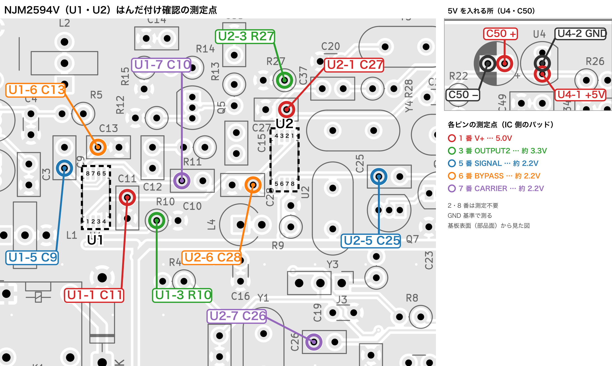

# NJM2594V（U1・U2）のはんだ付け確認

U1・U2（NJM2594V、SSOP8・0.65mm ピッチ）のはんだ付けが正しくできているかを、ほかの受信部品を付ける前に **4 点の部品だけ** で確かめる手順です。

- U1 = 第 1 混合（50MHz × 局発 → 12MHz）
- U2 = 積検波（12MHz × BFO）
- U1・U2 は回路が同じなので、2 個の測定値がそろっていることも判断の材料になります。

## 1. 用意する部品と道具

| 部品 | 値 | 役目 |
|---|---|---|
| U1・U2 | NJM2594V | 確認する IC |
| R10・R27 | 1kΩ | 3 番ピン（OUTPUT2、エミッタフォロア出力）の負荷抵抗。これがないと 3 番の電圧が決まらない |

R10・R27 はもともと付ける部品なので、確認後もそのまま残して組み立てを続けられます。78L05（U4）・リレー K1・パスコン・結合コンデンサは付けません。

- 安定化電源（5V、電流制限つき）
- テスター（電圧・抵抗・電流）
- ルーペ
- 細いテスター棒（隣のピンとの短絡に注意）

## 2. 手順 1　電源を入れる前の確認

ルーペとテスターの抵抗レンジで、ブリッジと電源のショートがないことを確かめます。

1. 隣り合うピン **1-2、2-3、3-4、5-6、6-7 番** の間を測り、0Ω 近くならブリッジです。
    - 5・6・7 番はどれも約 2.2V なので、電源を入れて電圧を測ってもブリッジが分かりません。ここで必ず確かめます。
    - 7-8 番は 8 番が NC（内部未接続）なので、つながっていても動作に影響しません。
2. U4（78L05）の 1 番パッド（V+）と 2 番パッド（GND）の間が 0Ω でないことを確かめます。

## 3. 手順 2　5V を入れて電流を確認

2 個とも付けた状態で、電流が **約 25〜35mA** なら正常です。

1. 安定化電源を **5V・電流制限 50mA** にします。
2. U4（78L05）のパッドへ入れます。**1 番が +5V、2 番が GND** です（C50 のパッドでも可。＋側が V+）。
3. 電流を読みます。12V の入力や K1 は使いません。

| 状態 | 電流の目安 |
|---|---|
| IC 1 個＋負荷 1kΩ | 約 14mA（消費電流 11mA、最大 14mA ＋ 3 番のアイドル電流 3.3mA） |
| U1・U2 の 2 個 | 約 25〜35mA |

- **ほぼ 0mA**：1 番（V+）か 4 番（GND）が浮いています。
- **約半分（14mA 前後）**：片方の IC の 1 番か 4 番が浮いています。
- **制限の 50mA に張り付く**：ショートです。すぐ電源を切ります。

## 4. 手順 3　各ピンの電圧

ピンが浮いていると、つながる先のパッドが約 0V になります。そのため **IC の足ではなく、つながる部品の IC 側のパッド** を GND 基準で測ります。目安はデータシートの端子電圧（V+ = 5.0V）です。

図の丸印が測る所です（色はピンごと、右上は 5V を入れる U4・C50）。図は `docs/tools/make_njm2594_points.py` で基板データから作っています。

| ピン | 名前 | 目安 | U1 で測る所 | U2 で測る所 |
|---|---|---|---|---|
| 1 | V+ | 5.0V | C11 のパッド | C27 のパッド |
| 3 | OUTPUT2 | 約 3.3V | R10 の IC 側 | R27 の IC 側 |
| 5 | SIGNAL INPUT | 約 2.2V | C9 の IC 側パッド | C25 の IC 側パッド |
| 6 | BYPASS | 約 2.2V | C13 の IC 側パッド | C28 の IC 側パッド |
| 7 | CARRIER INPUT | 約 2.2V | C10 の IC 側パッド | C26 の IC 側パッド |
| 4 | GND | 0V | — | — |
| 2・8 | OUTPUT1・NC | 測定不要 | — | — |

3 番の 3.3V は、1kΩ 負荷でアイドル電流 (5 − 1.7) ÷ 1k = 3.3mA が流れたときの値です。

## 5. 判定と異常時の原因

電流と 1・3・5・6・7 番の電圧が目安どおりで、U1 と U2 の値がそろっていれば、はんだ付けは正常です。

| 症状 | 考えられる原因 |
|---|---|
| 3 番が 0V | 3 番の浮き、3-4 番のブリッジ |
| 3 番が目安から少しずれる | 2-3 番のブリッジ |
| 5・6・7 番の 1 本だけ 0V | そのピンの浮き |
| 全部のピンが 0V または 5V 近く | 1 番または 4 番の浮き |
| U1 と U2 で値が大きく違う | 違う方の IC のはんだ付けを見直す |

## 6. 2 番ピンについて

2 番（OUTPUT1、コレクタ出力）はこの基板では使っていないので、**電圧の測定は不要** です。出力はインピーダンスの低い 3 番（OUTPUT2、エミッタフォロア）から取り出しています（データシートの応用回路「エミッタ・フォロア出力タイプ」でも 2 番は Open）。

- U1：3 番 → C12 → Q5（混合後の増幅）
- U2：3 番 → C37 → R28 → AF 前置増幅

ただし、**2 番もはんだ付けします**（IC を基板に固定するため）。手順 1 で 1-2 番・2-3 番のブリッジがないことだけは確かめてください。2-3 番のブリッジは使っている出力に影響します。

## 参考資料

- [秋月電子 NJM2594V（111195）](https://akizukidenshi.com/catalog/g/g111195/)
- [NJM2594 データシート（秋月電子）](https://akizukidenshi.com/goodsaffix/njm2594_j.pdf)
- [調整手順](調整手順.md)
